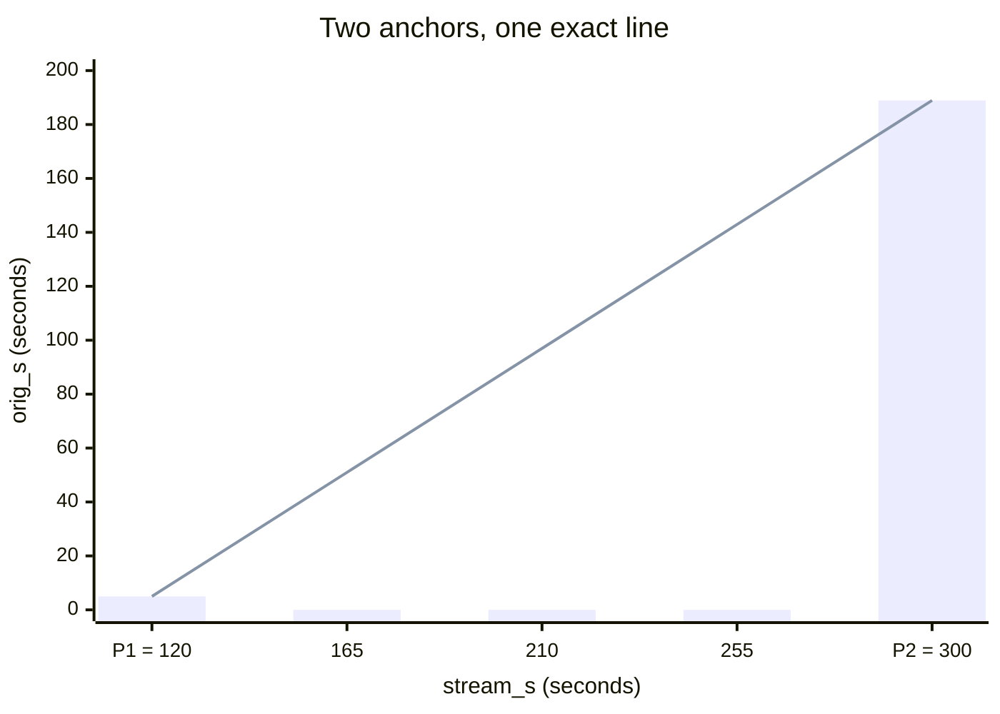
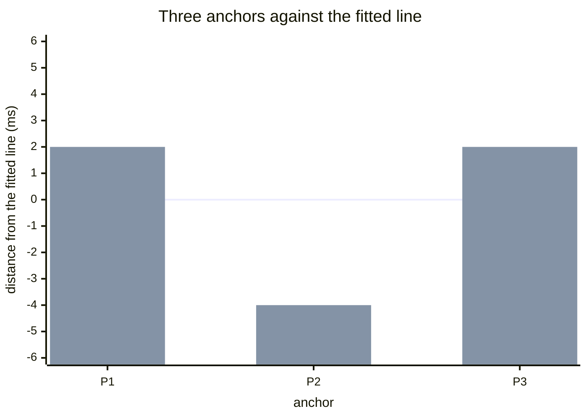
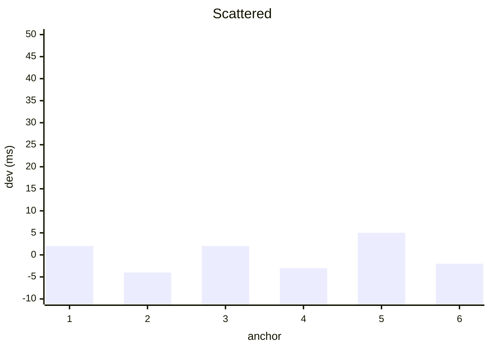
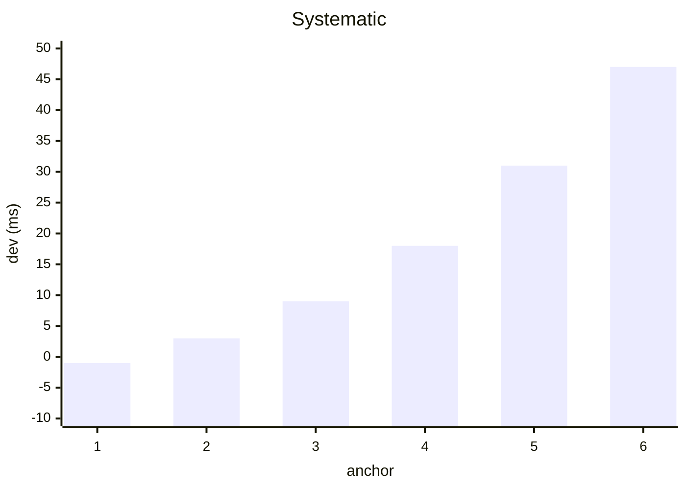
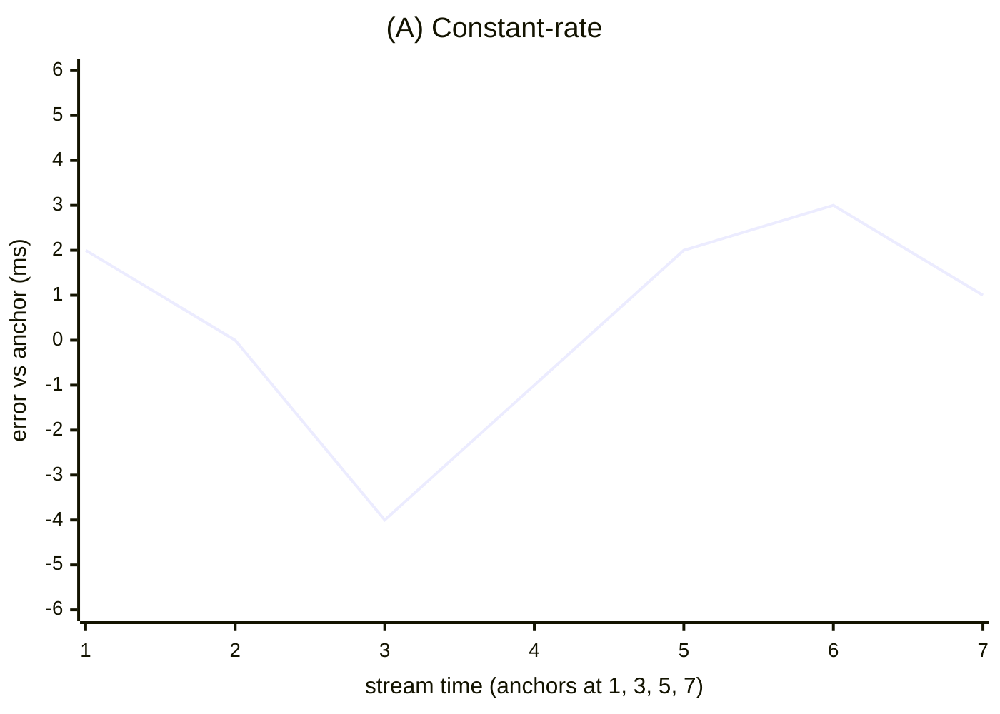
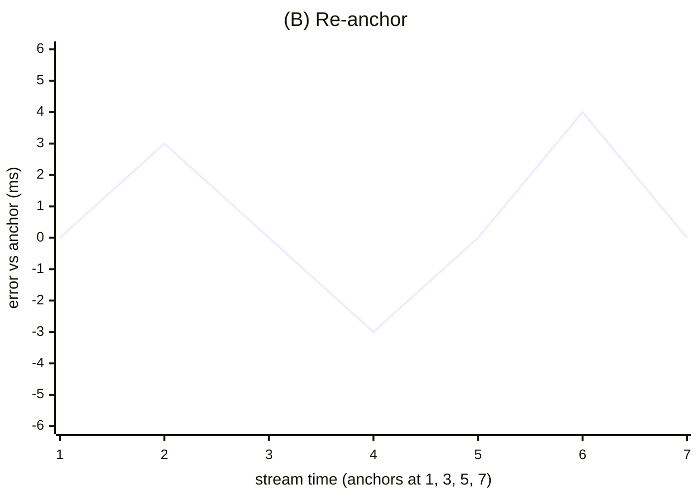
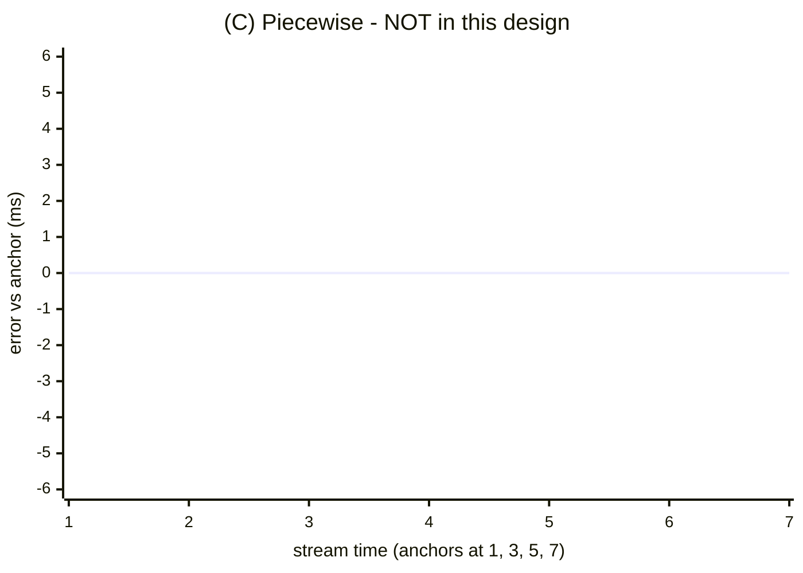

# PLAN — Micro-alignment tool (original ↔ stream null-test aligner)

> **What this is:** the design + build record of the micro-alignment tool — the `streamalign match-hints` converter (Pass 1) + `/align` inspector (Pass 2) that speed up seating an original track against the 1998 stream in Audacity. **Built & closed 2026-08-05** (see [Closing status](#closing-status-2026-08-05)); history sections stand as written. **Re-opened 2026-08-06 with one new active stream: [§6 DP-22](#6-dp-22--whole-song-lr-review-mode-design-2026-08-06), the whole-song L/R review mode** (broadcast annotation + alignment QA; web + Mac native surfaces).
>
> **Fits in:** [README](https://github.com/trjh/netradio_DNB_analysis/blob/main/README.md) (the analysis repo's master index). Sits beside [`PLAN_labelling_process.md`](https://github.com/trjh/netradio_DNB_analysis/blob/main/docs/PLAN_labelling_process.md) (the Audacity labelling automation) and [`PLAN_track_mix.md`](https://github.com/trjh/netradio_DNB_analysis/blob/main/docs/PLAN_track_mix.md) (the original↔mix alignment engine).
>
> Decision points (`DP-nn`) are listed in [`docs/DECISIONS.md`](https://github.com/trjh/netradio_DNB_analysis/blob/main/docs/DECISIONS.md).

| | |
|---|---|
| **Status** | Design 2026-07-28 · §5 revision 2026-07-29 · review 2026-07-30 · gate 0 PASSED 2026-07-31 · Pass 1 + Pass 2 BUILT through Phases A–E + the review-comment wave · **CLOSED 2026-08-05** — see [Closing status](#closing-status-2026-08-05); operator walkthrough: [`RUNBOOK_align_workflow.md`](https://github.com/trjh/netradio_DNB_analysis/blob/main/docs/RUNBOOK_align_workflow.md) · **DP-22 designed + BUILT through both surfaces 2026-08-06 (§6)** — web POC and the Mac-native POC (`native/align_review_app.swift`, §6.9-b); the §6.10 live-pass gates stay open |
| **Scope** | The **micro** moment of PROCESS.md step 9 ("Align the originals") / step 5 anchor-seating: nulling the residual between two very different renderings of the same audio. **Original ↔ stream only** (Q1) — stream ↔ stream alignment stays in Audacity |
| **Decisions** | all resolved 2026-07-30 — see [Open questions](#open-questions-all-resolved-2026-07-30) |
| **Depends on** | the already-built alignment math (`streamalign/align.py refine_offset`); gate 0 (§5.2): `sonic-annotator` + `match-vamp` install + export smoke-test |

## 1. The workflow today, and the precise pain

The origin brief was recorded on 2026-07-28. Summarised:

- The operator finds a good align spot, **marks it in the stream track and in the original
  track**, then plays both together, **frequently stopping to shift the original** to keep the
  two aligned.
- At the **next** good align point the **macro** line-up is easy, but **the micro is hard**
  because the two renderings are so different. Sometimes a clean zero-crossing match exists;
  often the fallback is **listening at slower and slower rates trying to ear-match drum beats**.
- The wish for those micro moments: **three slices — the stream (static), the original
  (shiftable), and the inverse-sum (or sum, switchable)** — so the original can be shifted to
  find the **minimal sum graphically**.
- Audacity probably can't do this natively; the brief asks whether a whole app, an Audacity
  plug-in, or an existing tool fits — and asks us to **check the process for other requirements
  not yet listed**.

**The macro step is already solved** — eyes/ears line up the phrase in seconds, and the
analysis engine's `streamalign hints`/`solo_anchors` even propose candidate spots. **The micro step
is the cost centre:** seating the exact corresponding sample-pair when the two signals are a clean
FLAC/CD original versus the DJ's EQ'd, level-ridden, lossy **16 kHz RealAudio** capture — different
timbre, different loudness envelope, and (because the DJ beat-matches) a **slightly different clock
rate**. That is why the ear-match at slower and slower speeds is slow and fatiguing.

The analysis repo's own `PROCESS.md` already documents this exact hand technique (its *"Aligning an
original to the mix (by ear + by eye)"* section):

- **Hear the seat** — hard-pan mix left / original right; off by a hair = a **flam** leaning to one
  ear, at the seat it collapses to one centred hit. Sharper: **phase null** — `Effect ▸ Invert` the
  original and listen to the sum; shared content thins toward a null (never silence — the mix has
  other layers).
- **See the seat** — at sample zoom, match the **timing** of peaks/zero-crossings, not their heights.
- **Nudge** — Sync-Lock moves the original + its `origNNN` labels as a unit; **"No numeric nudge
  exists"**; exact amounts require editing the head of the original (generate silence / delete
  samples). Time-Shift drag at sample zoom is sub-sample per pixel but fiddly.

So the pain is real and *named in our own docs*: Audacity gives the operator a **flam by ear** and a
**by-eye null**, but **no numeric, sample-accurate, snap-to-best nudge** and **no live inverse-sum
lane**. Everything is manual and ear-driven.

**The key insight this plan turns on:** the math that finds the seat automatically **already
exists** in the analysis repo. `streamalign/align.py::refine_offset()` computes the **GCC-PHAT**
sub-sample offset between two signals in a window and returns a **confidence** (normalised
correlation peak, 0–1). GCC-PHAT whitens the spectrum before correlating — which is precisely what
makes it robust to the EQ/timbre gap that defeats an eyeball null. **The residual minimum is a
computation, not an ear-marathon.** The tool's job is to put that computation at the operator's
fingertips and use the visual/aural null as **verification**, not as the primary search.

GCC-PHAT is *not* the same math as SV's MATCH aligner — they are near-perfect mirror images
(MATCH keeps spectral magnitude and discards phase; PHAT keeps phase and discards magnitude), and
each covers the other's blind spot. That comparison, and why the design now treats the refine
("combine") algorithm as a **switchable seam** between the two, is Appendix A.

## 2. Requirements

### 2.1 Explicit requirements (from the brief)

| # | Requirement | Source |
|---|---|---|
| R1 | **Three lanes:** stream (static) · original (shiftable) · **sum / inverse-sum, switchable** | brief |
| R2 | Shift the original to **minimise the (inverse-)sum graphically** | brief |
| R3 | **Playback of both** streams together | brief |
| R4 | **Label each** stream (place/emit a mark on stream and on original). *Relaxed for the §5 tool: it satisfies this by ingesting SV+MATCH align points into hints files rather than placing new marks. Stands in full for the ideal ubertool.* | brief |
| R5 | **Up to two originals live at once.** *Relaxed for the §5 tool (not exercised there — multiple originals would only be progress bookkeeping, Q5). Stands for the ideal ubertool.* | brief |
| R6 | Slowed playback (the current fallback: "slower and slower rates") | brief |

### 2.2 Requirements mined from the process (the ones the brief asked us to check for)

| # | Requirement | Why / source | Load-bearing? |
|---|---|---|---|
| M1 | **Snap-to-best.** One key computes `refine_offset` over a short window at the current shift, shows the residual and confidence, and jumps the original to the minimum. The visual/aural null is **verification**, not the only mechanism. | `align.py refine_offset` already does the GCC-PHAT sub-sample + confidence math; the ear-match is the current slow path | **Yes — the whole point** |
| M2 | **Polarity toggle — try both signs; the one that gets closer to null is correct.** (The inverse-sum trick is the classic *phase-null test*; original↔mix polarity *can* be flipped, and an inverse-sum with the wrong sign *sums* instead of nulling.) | PROCESS.md *phase null*; `PLAN_track_mix.md` polarity axis | **Yes** |
| M3 | **Show the residual-minimum / confidence number — grade by it, not by "is it silent".** The null never reaches silence: the mix is a different render (EQ, layers, lossy 16 kHz). Reinforces M1 over a pure eyeball null. | PROCESS.md ("won't reach silence"); `PLAN_track_mix.md` 2026-06-12 finding (raw waveform ncc ≈ 0.11) | Yes |
| M4 | **Snap-to-best works on a short window (a few seconds around one anchor), never the whole track.** Mix vs original differ by **offset + rate + polarity** because the DJ beat-matches (the rate-varying case, not pure offset) — so a constant-offset snap is only valid **locally**, matching the existing A/B anchor-pair practice. | `PLAN_track_mix.md`; PROCESS.md "anchor on moments the record plays alone" | **Yes** |
| M5 | **Output is Audacity label grammar, not a new format.** The tool emits paired anchors — `track sync: N` at the mix instant and `origNNN sync: N` at the original instant (and can ingest existing `origNNN`/`track` rows to seed the marks). It must **not** invent a format, and must **not** write committed `.labels.tsv` behind `sort_tsv.py`'s back. | the label grammar in `PROCESS.md`; `PLAN_labelling_process.md` | **Yes** |
| M6 | **Show the implied rate — an average across the selected alignment points (as the points change, the rate may change).** Consecutive pairs encode the local rate: `speed = (trackB − trackA) / (origB − origA)`. Sanity gate: a DJ pitches by a few percent, so a pair implying a rate far from ~1.0 is not both on the record. | `PLAN_track_mix.md`; `sheetscript/Code.js` | Yes |
| M7 | **Handle the differing sample rates (stream 16 kHz; originals 44.1/48 kHz FLAC/mp3/m4a/opus).** Decode to a common analysis SR before correlating (as `streamalign/audio.py` does via ffmpeg), but the output must **pinpoint the exact sample in the original's native encoding**; report nudges in ms **and** samples; round emitted label times onto Audacity's 0.001 s grid (= 16 stream samples). | `audio.py` (`SR = 16000`); the label grammar in `PROCESS.md`; decision made 2026-07-30 | Yes |
| M8 | **Loopable region around the align point + slow playback** (R6). Loop a few seconds centred on the anchor so the ear locks on one transient; slow rate to hear drum onsets. | brief; PROCESS.md ("coarse → transient → samples") | Yes |
| M9 | **Focus auto-alignment on un-mixed (solo) areas of the stream.** Consume `streamalign`'s `solo_anchors` (moments the record plays alone) as pre-seeded candidates; don't chase track start/end (records are blended, no objective "begins" frame). | PROCESS.md step 9; `streamalign hints` | Nice-to-have |
| M10 | **Two originals = the crossfade transition.** R5's "two originals" is the DJ crossfading record A out / record B in; align both against the same mix region. *(Like R5: stands for the ideal ubertool; not exercised by the §5 tool.)* | `PLAN_track_mix.md` (crossfades) | Clarifies R5 |

### 2.3 What a new tool MUST NOT break

- **Verified anchors.** `file [start] sync: … verified <neighbour>` rows carry the file-position
  authority and the `verified` connection record. This tool works the **`origNNN`/`track` (mix↔
  original) layer** — the original↔mix step (`PROCESS.md` step 9) — **not** the file-sync layer, so it does not touch file positions.
  State that boundary explicitly so a future build never writes a `file sync` row.
- **COMPLETE gates.** `file end: <stem> … COMPLETE` drives the "complete" status and the publish
  hard-gate. The tool never emits/edits `file end` rows.
- **The publish flow.** Committed labels reach the sheet only via `sort_tsv.py` (LABELTRACK
  expansion, grammar gate) → build → `validate` → `publish` → PR → merge → Reload. The tool emits
  anchors **into the Audacity label track** (or a `.starter`-style scratch the human folds in), so
  they pass through `sort_tsv.py` like any hand label. **No path writes `track-metadata.json` or a
  committed `.labels.tsv` directly.**
- **The server stays stdlib-only.** `align.py` needs numpy + ffmpeg; the server intentionally has
  no pip deps. A refine endpoint must **shell out** to the streamalign venv
  (`. .venv/bin/activate && python -m streamalign …`), exactly as `publish` already shells out
  — never `import numpy` into the server.

## 3. Options analysis (honestly costed)

### 3.1 Audacity native / Nyquist plug-in — **cannot do the live derived lane**

Nyquist plug-ins (and `mod-nyq-bench`) process a **selection** and **return** audio *offline* — they
do not render a live, real-time third lane that updates as you drag the original. There is no Audacity
primitive for a **live inverse-sum monitor bus**, and PROCESS.md already records the native gap:
**"No numeric nudge exists."** So R1/R2 (live switchable inverse-sum you shift against) are **out** for
native Audacity.

What Audacity *can* do, offline and one-shot (and the operator already does by hand): duplicate the
original, `Effect ▸ Invert`, `Tracks ▸ Mix and Render` with the mix, inspect the sum. That is the
*static* null, not the *interactive* one. **Verdict: (a) covers verification, not the micro search.
Rejected as the primary mechanism.**

### 3.2 Audacity + mod-script-pipe hybrid — keep the original environment, drive the nudge externally — **DROPPED 2026-07-30 (Q2)**

> **Status:** dropped at the 2026-07-30 review — a process that steps in and out of Audacity via
> `mod-script-pipe` would be clunky, and the tooling is crash-prone. Kept for the record.

Use Audacity exactly as today; add **one command / keystroke** that performs the sample-accurate
nudge currently done by hand. Verified against a `pyaudacity` checkout and the Audacity scripting reference:

**What the pipe supports (evidence from the checkout):**

- **`GetInfo: Type="Labels"`** → the two marks (label number, start, end, text). `get_info()` wraps it
  (returns JSON). ✅ read the stream mark and the original mark.
- **`GetInfo: Type="Clips"`** → each clip's **track + start + end**. ✅ read the original clip's current
  start (its current shift).
- **`SetClip: Track=… At=… Start=…`** — *"Modify a clip … Start position can be set."* **This is the
  numeric time-shift Audacity lacks in its UI, and it is scriptable.** ✅ drive the nudge:
  `Start := current_start − residual_seconds`. (pyaudacity's `set_clip()` is a `NotImplementedError`
  stub, but the underlying macro is real and callable via `do("SetClip: …")`.)
- **Playback:** `PlayAtSpeed`, `SetPlaySpeed`, `PlayAtSpeedLooped` → ✅ slowed, looped playback (M8/R6).
- **`Message: Text=…`** → ✅ surface residual + confidence back to the operator.
- **`Effect ▸ Invert` + pan** → the null/flam verification already in use, unchanged.

**The loop:** mark A/B in Audacity → hit the key → the companion (a) reads the two labels and the
original clip's start via `GetInfo`, (b) computes `refine_offset` on a **short window** at the current
shift **from the decoded originals on disk** (not by pulling samples over the pipe — `align.py` already
decodes/caches files), (c) `SetClip`s the original to the residual minimum, (d) `Message`s
`residual = X ms / N samples, confidence = 0.87`. The operator confirms by ear with the existing
pan/invert, seats the anchor pair, and moves on.

**Why it was the cheapest 80%:** it reuses the **already-built math**, the **already-checked-out
pyaudacity**, and the **venv that already exists** in the analysis repo, and adds **no new playback
engine**. The only new surface is a small CLI in `scripts/streamalign/`.

**Costs / risks (from the `pyaudacity` README + Audacity docs) — these are why it was dropped:**
- **`SetClip` precision on 3.7.8 is unknown** — does `Start=` accept sub-millisecond values and land
  sample-accurate? Would have needed its own mutation-bearing spike (the closed scripting-API
  spike of the labelling-automation plan is not evidence for it).
- Macros run over the pipe are **not in the undo history**; wrong params **fail silently**; a **pop-up
  dialog blocks all automation** until a human dismisses it; only the **last-opened** Audacity window is
  addressed.
- **Sync-Lock caveat:** the `origNNN` labels must move with the clip.

**Verdict: dropped 2026-07-30** — the §5 flow (SV+MATCH → converter → inspector) replaces it.

### 3.3 Server-hosted web tool (`/align`) — **the full realisation of the three-lane vision**

A new single-file vanilla-JS page served by the server: no build step, no framework. The **Web Audio API** gives everything R1–R6 asks for, natively and sample-accurately:

- **Sample-accurate dual/tri playback** — two/three `AudioBufferSourceNode`s on a shared
  `AudioContext`; the original's start is scheduled with an **adjustable offset** (re-schedule on each
  nudge, or drive an offset with sample precision). ✅ R3.
- **Live inverse-sum** — a `GainNode` at **−1** on the original summed with the stream on one bus; a
  toggle flips to **+1** for the plain sum. This is the classic **null test**, live and switchable. ✅
  R1/R2, M2 (add a polarity toggle so the null sign is a control, not a guess).
- **Three canvas waveform lanes** — stream (static), original (shiftable, drawn at the current offset),
  and the sum/inverse-sum lane whose amplitude visibly **shrinks toward the null** as it is nudged. ✅
  R1, the graphical minimise.
- **Keyboard nudge** — arrow = 1 ms, shift+arrow = 1 **sample**; both reported in ms **and** samples
  (M7). ✅ R2.
- **Slow playback** — `AudioBufferSourceNode.playbackRate` < 1 (drops pitch too — accepted, Q4; it
  actually *helps* hear drum onsets). **Loop region** via `loopStart`/`loopEnd` around the anchor. ✅
  R6/M8.
- **Two originals** — just more source nodes; the crossfade-transition case (M10). ✅ R5.
  *(Not exercised by the §5 tool.)*
- **Snap-to-best** — a server endpoint `POST /api/align/refine` that **shells out** to
  `streamalign refine` (M1; keeps the server stdlib per §2.3) and returns `{offset, confidence,
  residual_curve}`; the page plots the **residual curve** around the current shift and one key jumps to
  the minimum. The live null lane is then **verification**. ✅ M1/M3.
- **The refine endpoint's security contract (binding — this is a privileged capability on a
  no-auth-LAN server):** the request schema is **identifier-based, never path-based** — the client
  names a stream STEM and an original ID the server already knows (from its own file/label listings);
  the server maps them to paths itself and **realpath-containment-checks** every resolved path under
  the configured roots (`NETRADIO_MP3_DIR` / `NETRADIO_SOURCES_DIR`) before use. Numeric params
  (window seconds, search radius) are validated with hard caps (window ≤ 30 s, radius ≤ 2 s) so a
  request can't buy unbounded ffmpeg/FFT work. The subprocess is a **fixed executable + fixed
  argument list, `shell=False`**, values passed as discrete argv entries — nothing client-supplied is
  ever interpolated into a command string. **One refine at a time** (a module lock; concurrent
  requests get 429-style refusal) and the endpoint is **loopback-only unless Basic Auth is enabled**
  (the same posture as the server's other write routes): the LAN-open server must not expose compute-on-demand or file probing.
  Tests must cover: traversal/absolute-path identifiers refused, cap enforcement, the argv shape
  (seam-asserted), the concurrency refusal, and the loopback/auth gate. ✅ §2.3.
- **Label export in exact grammar** — the page emits `track sync: N` (mix instant) + `origNNN sync: N`
  (original instant) rows and shows the **implied rate** across the pairs (M6); export as a downloadable
  `.labels.tsv` snippet or a `.starter`-style scratch the human imports into Audacity — **never** a
  direct commit (M5/§2.3). ✅ R4.

**Costs / new surface:**
- Needs the **originals** readable by the server (new `NETRADIO_SOURCES_DIR` / reuse
  `NETRADIO_AUDIO_DIR`, pointing at the analysis repo's `sources_local/`); the stream MP3s it already
  serves with Range. *(Approved, Q3 — on the server's host.)*
- The refine endpoint depends on the streamalign venv (numpy + ffmpeg) as a **subprocess** — dark, and
  degrading gracefully, when that venv/path is unset (same pattern as the rest of the app).
- **More build than (b)** — a real page + audio graph + endpoint — but fully **within our control** (no
  dependence on Audacity internals / SetClip), and it is the only option that delivers R1/R2 as the
  brief drew them (the shiftable original against a live inverse-sum).

**Verdict:** the durable, self-contained answer — re-shaped by §5 from a free three-lane editor into
the per-sync-point **inspector** (§5.3).

### 3.4 Existing tools survey

| Tool | What it does vs. our requirements | Gap | Cost / platform |
|---|---|---|---|
| **Reaper** (DAW) | Genuinely covers the *interactive* side: multi-track waveform view, **polarity flip** on the routing panel, configurable **nudge down to 1/100 sample**, live playback, and a **correlation meter on the sum bus** for the null. So Reaper can do a live null + sample nudge + slow playback. | Knows **nothing** of the `.labels.tsv` grammar or the master timeline — you'd hand-transcribe every anchor back. Its "instant phase align" auto-tools target **multi-mic** (same capture, small delay), not EQ'd-lossy-vs-clean with a DJ rate offset — no snap-to-best for *this* material. A whole-DAW switch. | ~$60–225 licence; mac/win/linux |
| **Sound Radix Auto-Align 2** | Real-time **delay + polarity + spectral all-pass** to phase-align multiple mics of the **same source**. | Designed for multi-mic of one signal; the **DJ rate difference** and **lossy-vs-clean/different-master** gap are outside its envelope. It's a mix-time plugin, **not** an anchor-emitting alignment tool — wrong output shape. | ~$100–200; VST3/AU/AAX |
| **Sonic Visualiser + MATCH Vamp plugin** | **Closest to the whole problem.** MATCH (Simon Dixon's DTW alignment) overlays two recordings and computes a full **rate-aware alignment path**, then locks scroll/playback of both — exactly the **feature-based DTW** that `PLAN_track_mix.md` concluded is the right tool for rate-varying mix-vs-original. Free / open-source. | Produces an alignment **path for viewing/playback**, not `origNNN sync:` anchor rows; **no live inverse-sum lane, no sample nudge editor**. It's a visualiser, not an editor. | **Free**; mac/win/linux |
| **VocALign / Revoice Pro** (Synchro Arts) | DTW time-warp of one take to match another (ADR / vocal doubles). Same DTW family. | **Warps the audio** rather than emitting anchors — wrong output; and it fights, rather than records, the DJ's rate drift (which we *want* to keep as A/B pairs). Expensive. | ~$260–600+; VST/AU/AAX |

**Survey conclusion:** nothing off-the-shelf **emits the netradio label grammar or knows the master
timeline**, so every tool leaves a manual transcription gap — the exact gap M5 exists to close. Reaper
gets closest on the *interactive null + sample nudge*; **Sonic Visualiser + MATCH** gets closest on
*rate-aware auto-alignment* and is **free and open-source** and is literally the DTW that
`PLAN_track_mix.md` already wants. Neither removes the need for our small bridge. **Recommendation:
trial Sonic Visualiser + MATCH now, at zero cost, as an alignment oracle / anchor-proposer** (evaluate
its DTW path at chosen instants → candidate `orig`/`track` pairs), while we build the bridge that turns
alignments into grammar-correct anchors. *(Trialled — it works; see §5.)*

## 4. Initial recommendation & phased build plan (2026-07-28)

> **Status 2026-07-30:** superseded in part by §5. Phase 0's SetClip spike and Phase 1 are
> **dropped** with option §3.2 (Q2: avoid `mod-script-pipe`). Phase 2 is re-shaped into the §5.3
> inspector; Phase 3 lives on as the §5.2 converter. Kept as the record of how the recommendation
> evolved.

**Build our own bridge — don't adopt a DAW wholesale** — because the load-bearing requirement (M5:
emit the exact `origNNN`/`track` grammar, on the master timeline, without breaking the publish gate) is
the one thing no external tool does, and because **the hard part (the residual-minimum math) is already
built**. Deliver it in two tracks, cheapest-relief-first, and use the free oracle in parallel.

- **Phase 0 — the SetClip precision spike** *(dropped with option §3.2)* — a THROWAWAY-project
  experiment to prove `SetClip: Start=` lands sample-accurate. The *other* half of Phase 0 —
  install **Sonic Visualiser + MATCH** and trial it as an alignment oracle — **happened in the
  field and passed** (§5).
- **Phase 1 — Hybrid snap-to-best (option b)** *(dropped 2026-07-30, Q2)* — the one-keystroke
  in-Audacity nudge via the pipe.
- **Phase 2 — The `/align` web page (option c).** Stream (static) · original (shiftable) · **live
  switchable inverse-sum/sum** lanes; Web Audio sample-accurate offset; keyboard nudge (ms +
  sample); polarity toggle; slow + looped playback; `POST /api/align/refine` (shelling out to the
  venv) for snap-to-best + a plotted residual curve, with the live null as verification. Originals
  read via `NETRADIO_SOURCES_DIR`; the whole page is **dark** when sources/venv are unset.
  *(Re-shaped by §5 into the per-sync-point inspector.)*
- **Phase 3 — Emit anchors back into the pipeline, cleanly.** From either tool, export
  `track sync: N` + `origNNN sync: N` pairs (rounded onto the 0.001 s grid) as a `.starter`-style
  scratch the human folds into the Audacity label track — passing through `sort_tsv.py`'s LABELTRACK
  expansion and grammar gate, **never** a direct commit. Show the implied **per-pair rate** as the M6
  sanity gate; consume `streamalign solo_anchors` as pre-seeded candidates (M9). *(Lives on as the
  §5.2 converter.)*

## 5. Plan: Sonic Visualiser + MATCH + Align Web App

*(Revision 2026-07-29; field-corrected + workflow pinned 2026-07-30.)*

SV+MATCH was trialled in the field and works startlingly well — **open question 6 is answered**.
The flow now is: **Audacity stays the tracking canon; SV+MATCH is the alignment oracle when a new
track is introduced**; a converter turns its align points into label/hints files (Pass 1); a web
**sample inspector** verifies and hand-tunes each point (Pass 2 — this *re-shapes* §4's Phase 2
from a free three-lane editor into a per-sync-point inspector).

### 5.0 The pinned workflow (2026-07-30)

The section-5 tooling serves exactly this loop:

1. **Identify** the next stream file to be worked on, and the originals contained in it.
2. **Pick alignment points** for each stream+original pair via the MATCH process (CLI first —
   gate 0, §5.2 — then the web inspector).
3. **Emit** those points into `hints.labels.tsv` files for the original and for each stream
   (existing grammar, Q7).
4. **Fold + validate in Audacity** as part of the already-defined Audacity process (PROCESS.md).
   Audacity remains where everything comes together.

### 5.1 Using SV+MATCH better (the three field questions)

The field process that produces a working aligned session (2026-07-30):

1. Open the stream file in SV.
2. Convert the original file to WAV.
3. **⌘I** to add the original file into its own pane.
4. Click **"Align File Timelines"**.

After this, playback works and clicking a pane switches which file plays. The three questions:

- **Playing both tracks merged — field-corrected 2026-07-30.** The docs say *Solo Current Pane*
  (the **S** speaker toggle) un-soloed should mix all panes, with the non-playing file warped to
  follow; **in the field it does not** — with the alignment active, the S toggle no longer
  produces a mixed playback; playback simply follows the clicked pane. So merged A/B listening
  (and the null test) belongs to the inspector (§5.3), not SV. (There is also no per-pane gain
  control, which pointed the same way even before the field check.)
- **Exporting the merge points:** the built-in session alignment (the 4-step process above) **is
  not exportable from the UI** — field-confirmed: File ▸ Export in the aligned session only
  offers *audio*; the alignment layer never appears as an exportable annotation layer. That's
  because the built-in aligner uses MATCH internally but exposes no transform layer. The same
  MATCH engine ships separately as a Vamp plugin (`match-vamp`), and **as a plugin it takes the
  two recordings as the two channels of ONE input** — it cannot be pointed at two separate open
  files. So both export routes go through pairing first, and **neither is smoke-tested yet**
  (validating ONE of them end-to-end is gate 0, §5.2):
  - *Headless route (preferred — CLI is the desired shape):* sonic-annotator's **`-m`
    (multiplex)** flag does the pairing itself:
    `sonic-annotator -m -d vamp:match-vamp-plugin:match:path stream.wav original.wav -w csv`
    (confirm the installed transform id with `sonic-annotator -l` first; without `-m` the
    files are analysed separately and no pair alignment is produced).
  - *GUI route (requires the `match-vamp` plugin installed — this is why it isn't visible
    today):* build a two-channel pair file — both recordings resampled to one rate, one per
    channel, e.g. `ffmpeg -i stream.wav -i original.wav -filter_complex
    "[0:a]aresample=44100,aformat=channel_layouts=mono[a];[1:a]aresample=44100,aformat=channel_layouts=mono[b];[a][b]amerge=inputs=2[o]"
    -map "[o]" pair.wav` (each input constrained to mono before `amerge`, or the filter
    graph refuses to choose formats) — open *that* file alone in SV, run the MATCH transform on
    it (Transform ▸ … ▸ Match Performance Aligner — present only once the plugin is installed),
    and File ▸ Export Annotation Layer (CSV) on the resulting path layer.

  Whichever route gate 0 proves, its CSV path is the Pass-1 converter's input.
- **Ranking align points:** MATCH itself doesn't rank; its path is a continuous warp with a
  frame-level cost, not "good spots". Ranking is **ours to do and cheap**: for each candidate
  instant, run the refine step on a short window and score by **residual depth + peak
  sharpness**; prefer candidates spread across the track and at transient-rich moments. The
  converter ranks and marks the top-K; "visually distinct spots" becomes a number.
  **The refine ("combine") algorithm is a switchable seam (new 2026-07-30):** GCC-PHAT
  (sub-sample, constant-offset) or a MATCH-family DTW cost (rate-aware, frame-level) — they are
  mirror-image algorithms with complementary blind spots (Appendix A), and running both at a
  candidate and checking agreement is the cheapest cross-validation.

**Field data (2026-07-30)** — two anchor pairs read off the aligned session, stream `d376-395`
(left pane) ↔ original `072` (right pane), time and sample readouts as displayed:

| pair | stream | original |
|---|---|---|
| 1 | 1:09.472 (1,111,554) | 1:39.134 (1,586,155) |
| 2 | 3:14.315 (3,109,040) | 3:46.699 (3,627,184) |

Three observations fall out:

- **The M6 rate math works on real data:** Δstream/Δorig = 1,997,486 / 2,041,029 ≈ **0.9787** —
  the original runs ~2.1 % fast in the mix, comfortably inside DJ-pitch range. Sanity gate passes.
- **All four sample numbers are on a 16 kHz grid** (each ≈ displayed time × 16000) — the session's
  sample readout followed the first-opened (stream) file, **not** the 44.1 k timeline §5.2's math
  originally assumed. Gate 0 must pin the export's actual units from a real CSV; M7's
  "exact sample in the original's native encoding" requirement stands regardless.
- **The warp is continuous, not a skip between well-defined match points** (it initially looked
  like the latter) — consistent with MATCH being a frame-level path (Appendix A), and exactly why
  the *converter*, not SV, picks the discrete anchors.

**Field guide — getting the best out of SV + MATCH** *(distilled from the docs + field use;
anything the gate-0 smoke test contradicts gets corrected there)*:

1. **Work from WAVs, not MP3s**, when the numbers matter (the field process already converts):
   different MP3 decoders can emit different sample counts/padding, so a sample number read
   against one decode may not match another. Align against the same decoded files the converter
   will read.
2. **Interactive alignment** is the 4-step field process above (open stream → convert original →
   ⌘I import → Align File Timelines); MATCH computes in the background and the panes scroll-lock.
3. **Listening:** playback follows the clicked pane, warped to the alignment; merged playback is
   **not** available in the field (first bullet above). The playback-speed wheel (bottom-right)
   still gives the slowed-down listen for ear-matching.
4. **There's no per-pane gain** (and no merged playback), so the balanced A/B and the null test
   belong to the inspector (§5.3), not SV.
5. **Pick anchor moments, not stretches:** transient-rich, spectrally distinct instants — a
   break coming in, a stab, a bass drop — and spread them across the overlap. Avoid long
   pads/noise beds (flat correlation, MATCH can drift there). The converter re-ranks whatever
   you pick, so over-collecting is fine; under-collecting near the edges is the real loss.
6. **Never read authority off the warped view:** SV resamples to a common session rate to align
   (the field data suggests the first-opened file's rate), so treat everything seen there as
   *hints*; exact positions come from the exported path CSV through the converter's rational
   sample-rate math (§5.2).
7. **Level-match first if one side is much quieter** (rough gain in SV or ffmpeg before
   aligning): MATCH's features are loudness-sensitive at the margins, and the stream's
   compressed dynamics are already a handicap.
8. **Export** needs gate 0 (§5.2) — the headless `-m` route or the pair-file transform above;
   until one passes, keep marking points by hand in Audacity as today.

### 5.2 Pass 1 — the converter (align points → label tracks / hints files)

> **Status: ✅ BUILT 2026-07-31 — analysis repo PR #120 (`streamalign match-hints`), Local
> Reviewer passed.** One command (`match-hints d376-395 72`) runs MATCH headless, recovers
> rate + polarity + ranked anchors, and emits the paired `.match.hints.tsv` files. On the
> field pair it lands on the ear-verified seat to **7 ms** with no prior anchor input.
> Build findings that revised the design (all encoded as code + tests):
> **(a)** the raw MATCH path is coarse-map-only — the converter re-derives everything via a
> GCC-PHAT-confidence-scored rate sweep; **(b) the loop trap is real and severe**: on this
> material rival seats exist at whole-bar shifts (a 4-bar (~6 s) and a ~34-bar (~48 s)
> shifted seat both scored well) — disambiguated by **whole-overlap anchor mass** (the true
> seat explains the whole overlap), with `note QUESTION:` rows emitted when coverage is thin
> or a rival is close; **(c)** `refine_offset` gained a multi-peak variant + wide-radius
> correctness fixes in `align.py` (peak search now honours its radius contract).

A small analysis-repo CLI: MATCH path CSV in → ranked align points → emitted hints labels.

**Gate 0 — ✅ PASSED 2026-07-31** (headless route, on the real field pair d376-395 ↔ 072):

- **Export proven:** match-vamp built from source (arm64) + sonic-annotator 1.7; transform id
  `vamp:match-vamp-plugin:match:path` / `:a_b`; `-m` multiplex emits `time_in_A,time_in_B`
  CSV at 20 ms hops in ~6 s for a 20-min stream. Units: seconds on the **first file's rate**
  (16 kHz) — confirming the §5.1 field observation.
- **A raw MATCH path is a coarse map, not an anchor source.** Its online DTW is forced to
  start files-together; on a 20-min mix containing a ~6-min record it lands seconds off
  (−3…−8 s even after coarse trimming; parameter sweep across chroma/metric/zonewidth barely
  moves it) and reports the rate wrong. The path (or the operator's macro mark / `hints`) only
  tells the precision engine **where to look**.
- **The precision engine that works — verified end-to-end:** coarse seat → global rate →
  **rate-corrected** windowed GCC-PHAT, **both polarities** → confidence + neighbor-consistency
  ranking. On clean passages conf reaches **0.72** (planning assumed ~0.11) and the seat agrees
  with the SV hand-read to **8 ms**; the offset curve across the overlap is smooth (−27.74 →
  −27.42 s — the DJ riding the pitch, ~0.3 s over 4 min), so per-point anchors are confirmed
  necessary.
- **Un-corrected PHAT fails outright at ±2.2 % rate error** (conf ≈ 0 — the window smears
  ~22 ms per second of window): rate correction *first* is mandatory. Quantifies M4.
- **Polarity is detectable per-anchor** from the correlation sign — and 072 *is* inverted vs
  the stream (M2 in the wild).
- **Ranking must gate on neighbor-consistency, not confidence alone:** two mid-conf anchors sat
  ~0.6 s off the smooth curve (DnB loop self-similarity grabbing the wrong repetition).
- **M7 addendum:** original 072 is **48 kHz** — the rational conversions need 3/1 (48k→16k) as
  well as 441/160.

The conversion itself, for align point N with **SSN** (stream sample number) and **OSN**
(original sample number) on the export's common grid:

- stream-hints file: original-start = (SSN−OSN) converted to 16 k · track-sync = SSN → 16 k ·
  original-end = start + original length (→ 16 k); original-hints file: original-sync = OSN
  converted to the original's **native** rate (M7: the exact native sample).
- **Keep the sample-rate math rational:** 44100/16000 = **441/160 exactly**. Keep sample
  numbers integer at their native rates, convert once via the exact rational, emit seconds at
  6 dp (Audacity label precision). Never round through floats twice — this is precisely the
  "resampled view is hard to match back" pain, closed by construction.
- **Naming (Q7 — resolved 2026-07-30): emit the existing grammar.** The names above are
  shorthand for the existing `origNNN sync:` / `track sync:` forms, which the converter emits so
  `sort_tsv.py`'s gate and the parsers stay untouched; only a genuinely-new form (an original
  *end* sync) gets defined in the label grammar guide in the same PR.

### 5.3 Pass 2 — the `/align` sample inspector (mockup: [docs/mockups/align_tool_inspector.html](https://github.com/trjh/netradio_DNB_analysis/blob/main/docs/mockups/align_tool_inspector.html))

> **Status: ✅ v1 BUILT 2026-07-31 — `/align` + `align_inspect.py` on the server + analysis
> PR #121 (`streamalign inspect-slice`, the DSP provider, stacked on #120). Local Reviewer
> passed on both.** Delivered per the accepted v1 scope (converter + inspector, overview
> deferred): hints-driven pair/point pickers, the three lanes with drag/±smp/±ms nudging on a
> shipped 0.5 s margin (no round trip per keypress), snap-to-best (live-verified recovering a
> 5 ms-off seat to the sample), combined/subtraction playback with loop + speeds + routing,
> L/R/both channels, both residual displays, the full §3.3 security contract.
> **Calibration finding (live):** at ncc ≈ 0.6 the achievable subtraction null is bounded at
> √(1−ρ²) ≈ 80% — even a verified seat reads ~100% whole-window residual — so the color
> thresholds below are provisional until the planned interactive calibration; the refine
> confidence readout is the trustworthy number meanwhile.
>
> **Phase D 2026-08-01 (server `feat/align-export` + analysis `feat/overview-dsp`): the
> deferred pieces landed.** The **overview zone** below is ✅ BUILT (DP-10; collapsed-by-default,
> whole-capture envelopes via `inspect_slice.build_overview`, numbered flags colored by each
> point's measured residual through the DP-11 gradient, click-to-jump to the nearest point),
> and the **include-in-results export** is ✅ real (DP-16; per-point include toggles + an Export
> button downloading the two Pass-1-grammar `.match.hints.tsv` files with the session's
> adjusted, `verified`-marked seats — browser download only, never a server write; since
> 2026-08-30 it sits beside the DP-24 §3 **compile summaries** button, whose one server write
> is the derived `labels/summary/`). A
> standalone launcher `scripts/run_align.sh` (DP-17) starts/stops `align_server.py`.
>
> **Review-comment wave 2026-08-04 (server `feat/align-rc-ux`): the user's live-review items
> DP-27..DP-32.** Overview flags moved to the lane's **bottom edge** (they hid behind the legend
> text); the Context strip and Controls sections **swapped places** and the controls' text grew
> 2 points; the inspector title gained the **original-native clock** (`orig M:SS.mmm native` =
> `seatNow()`, live on snap/nudge/drag); per-pair **adjustments persist** in localStorage
> (`netradio.align.adjust.<stem>|<NNN>`, restore note + discard button on reload); points now
> **default to NOT included** with a three-state marker (gray untouched · residual-colored
> examined · ✓ included — only ticked points export); refined points export the **refine's
> confidence** (n = ncc × 10) instead of the hint's. `parse_match_hints` is pinned to accept
> anchor rows with and without the trailing ` HINT` (cross-repo DP-26 transition), and
> `run_align.sh status` now sends Basic Auth on its DSP probe (401 reads "UP (auth
> required)", never "unknown").
>
> **DP-18 + DP-33 2026-08-05 (server `feat/align-overview-plus`, stacked on the review-comment wave).**
> The overview now draws **every pair on the current capture**: the loaded pair's flags stay
> bright exactly as before, every other hints set renders as a **muted stacked row** above
> (dimmed/desaturated, still numbered, orig tag at the row's left) from the sources data
> alone — zero extra DSP fetches; clicking a foreign flag **switches the pair selector** to
> that pair at the clicked point (normal pickPoint→fetchSlice chain, reqToken staleness
> untouched), and overview payloads are cached per (pair, rate, invert) key — at most one
> DSP fetch per key, so switching back is free. The warped band stays current-pair-only.
> And the engines' disagreement is now **drawn, not smoothed** (DP-33): `parse_match_hints`
> captures the Pass-1 per-anchor `MATCH %+.3fs` deltas as `match_delta_s`, the page rebuilds
> the MATCH path by linear interpolation between those anchors, and the context strip AND
> the overview carry a midline **jitter band** showing |b_match(t) − b_line(t)| against the
> seat-implied line `seatNow() + (t − stream_t)·rate` — half-height and color ∝ the gap
> (green ≤ 20 ms ≈ one MATCH frame → red ≥ 100 ms, height capped at 150 ms), with a
> "MATCH−PHAT gap, ms" legend carrying the numeric gap at the seat, live on every
> snap/nudge (the line moves; the path doesn't).
>
> **DP-34 2026-08-05 (server `fix/jitter-inspector-overlay`, chain 6/6).** Live review
> of the DP-33 band: on the overview/context the bars "aren't helpful there and reduce the
> amount of data shown". Those two lanes are back to their pre-DP-33 rendering (pure
> envelopes + flags, full data density); the same |b_match − b_line| visualization now
> rides the **inspector's stream + original lanes** as a **light overlay**, drawn only
> where the MATCH path covers the window (never extrapolated), with the legend + the
> numeric gap at the seat on the inspector's metrics line. **DP-35 (same PR; verdict: the
> first cut — a 4 px bottom ribbon — was too subtle):** the overlay is a per-x translucent
> tint of the **whole lane body** (alpha 0.12), clean at ≤ 20 ms (≈ one MATCH frame — the
> shading reads as *flagged sections*, not wallpaper), `jcol` green → red above; and the
> **lane titles explain the shading in words** ("shaded sections: the MATCH cross-check
> disagrees with the current seat (green → red = gap in ms)"), appended only when the
> loaded pair has a MATCH path. Same page-side math, same 150 ms cap, still live on every
> snap/nudge/drag.

Three zones, per the brief.

**Overview zone (top):**

- stream waveform with numbered sync flags;
- the original drawn under it, **piecewise-linearly stretched between sync points** (true DTW
  warp display deferred — the anchors are what matter);
- legend of point numbers + a quality strip (each point's refine residual).

**Controls (middle):**

- point selector · window size · playback speed · zoom;
- invert-original (the M2 polarity toggle) · include-in-results;
- **refine-algorithm selector (new 2026-07-30): GCC-PHAT ↔ MATCH-cost** — the switchable
  combine seam (§5.1, Appendix A); *(not yet in the mockup)*;
- channel routing (stream-L/orig-R ↔ both stereo);
- **show L only / R only / both** — a *channel* selector (decided 2026-07-30), not lane
  visibility: the stream captures are 16 kHz **2-channel** files and the originals stereo, so
  "L only" draws the left channel of *both* signals, "R only" the right of both, and "both"
  draws **two signal lines per lane** (Audacity-style stacked L over R; the diff lane subtracts
  per-channel and stacks likewise);
- residual display toggle (see Inspector below).

**Keyboard shortcuts (decided 2026-07-30):**

- `space` play-combined · `s` play-subtraction (the two playbacks were the explicit asks);
- `[` / `]` playback slower / faster (the third explicit ask);
- `←` / `→` nudge ∓1 sample (shift = coarser) — rides along since hands are already on the keys.

**Inspector zone (bottom):**

- stream slice fixed; original slice **draggable by hand / ±ms / ±sample**, plus the
  snap-to-best button (M1);
- a **subtraction lane** whose residuals render in one of two switchable forms (decided
  2026-07-30):
  - **default — *colored sum graph*:** the residual colors are the lane **background**
    (point-alignment color filling the 10 % window, sample-alignment color outside it) and the
    subtraction waveform is drawn in **black or white ink, whichever contrasts more** against
    each background region;
  - *separate boxes:* two solid graded-color blocks labelled **"sample alignment"**
    (whole-window residual) and **"point alignment"** (the 10 % window), each half the width and
    half the height of a waveform box, text inside;
- the **point-alignment number is the decision-maker**; the 10 % window is marked on all three
  lanes;
- play-combined and play-subtraction buttons (shortcuts above);
- the **server does the DSP** (slice, resample, RMS-match, subtract, metrics) through the §3.3
  security contract — the browser only draws and plays.

**DSP notes** *(short form — full rationale in Appendix B)*:

- **RMS is the right first measure** for the energy match — computed on the **comparison
  window** (widened per 2026-07-30, never the whole file) and on **band-limited** signals: all
  comparison DSP at 16 kHz, residual reported as the scale-free ratio RMS(diff)/RMS(stream).
- **Color thresholds get calibrated interactively during the build** (decided 2026-07-30) on
  2–3 known-good syncs — not taken on faith; log-scale gradations; a small
  cross-correlation-peak readout beside the bars covers the case where subtraction depth
  misleads but alignment is right.

### 5.4 Effort (sessions ≈ one reviewed PR each) & alternatives

| Piece | Effort |
|---|---|
| Pass 1 converter (CSV → ranked points → labels/hints, tests) | **1** |
| Pass 2 inspector v1 (server DSP endpoint + inspector zone + playback; **no overview zone**) | **2** |
| Overview zone (piecewise-warped original, legends, quality strip) | **+1–2** |
| Polish (routing options, settings persistence, include-in-results export) | **+1** |
| MATCH-cost engine behind the refine seam (GCC-PHAT ships first) | **+0.5** |

Recommended v1 = **3 sessions** (converter + inspector); full vision ≈ **5–6½**. Alternatives:
**(a)** defer the overview zone (−1–2; the inspector is where decisions happen — recommended);
**(b)** SV-only flow, no web tool (converter + Audacity ear-check; **1 session** total, loses
the subtraction visuals); **(c)** auto-rank + preselect top-K so the human only audits (+0.5,
large listening-time saving — recommended with (a)); **(d)** server-rendered waveform PNGs
instead of client canvas (≈same effort, less JS risk, laggier dragging — not recommended for
the inspector, fine for the overview).

**Accepted 2026-07-30 (Q8):** v1 = converter + inspector with the overview zone deferred —
alternatives (a) + (c).

## Open questions (all resolved 2026-07-30)

1. **Scope:** ✅ **original ↔ stream only.** Aligning different stream files against each other
   is much easier and better done in Audacity — out of scope for this tool.
2. **Hybrid vs. web-first:** ✅ **avoid `mod-script-pipe`** — a process stepping in and out of
   Audacity via the pipe would be clunky, and that tooling seems crash-prone. Moot in practice:
   the §5 tooling comes first; §4's Phases 0–1 are dropped.
3. **Originals path:** ✅ yes — `NETRADIO_SOURCES_DIR` pointing at the analysis repo's
   `sources_local/`, and the refine endpoint as a **subprocess** to the streamalign venv (server
   stays stdlib). On the server's host, for this tooling, this is fine.
4. **Slow playback pitch:** ✅ pitch-dropping slowdown is just fine.
5. **Two originals:** ✅ mostly moot given §5 — in a full Audacity-replacing tool, multiple
   originals would only help keep track of progress, not serve mixing. (R5/M10 stand for the
   ideal ubertool; relaxed for the §5 tool.)
6. **Oracle:** ✅ answered in the field (2026-07-29) — SV+MATCH trialled first-hand, "amazed at
   how well it works"; now part of the flow (§5).
7. **Hint-name grammar:** ✅ **keep the existing grammar** (`origNNN sync:` / `track sync:`) —
   the names in the §5 brief were shorthand for the existing forms; only genuinely-new forms
   (original *end* sync) get defined in the label grammar guide in the same PR (§5.2).
8. **Scope order:** ✅ converter + inspector first (3 sessions); overview zone deferred (§5.4).

## 6. DP-22 — whole-song L/R review mode (design 2026-08-06)

> **Status: DESIGN (2026-08-06) — the plan's next active stream.** The framing parameters
> below are **decisions, not options** — made 2026-08-06 and refined live in the same
> session's design Q&A (the A1–A5 answers folded in below supersede the first-draft
> defaults) — and this section elaborates them into a buildable shape. Everything above
> stands as written and stays closed ([Closing status](#closing-status-2026-08-05)); DP-22
> is a new, separately-gated stream layered on the built tool.

The closed §5 tool works **one sync point at a time** through a few-second window. DP-22 adds
the complementary listen: **play the whole pair** — the capture in one ear, the rate-corrected
original in the other — from before the record enters to after it leaves. Dual use, both
first-class (decision 1):

- **Broadcast annotation** — hear and mark *where the DJ mixes in/out*, IDs, rate trouble,
  anything worth a note, against the whole song rather than a 6-second slice;
- **Alignment QA** — a wandering seat is instantly audible as inter-ear flam/echo growth
  (the PROCESS.md hard-pan trick, §1, stretched over the full overlap). This whole-song
  ear-pass is the intended vehicle for the **DP-20 backlog** (45 NOT-FOUND hand sync points
  needing an ear each), phone-first so it can be done from the sofa.

### 6.1 Presentation (decision 1)

- Stream hard-panned **LEFT**; the rate-corrected original hard-panned **RIGHT**.
- **One-tap L/R swap** (flip both pans — ear fatigue and earbud orientation are real).
- **Solo-stream, two forms (A1): a momentary hold AND a latching toggle.** Held or latched,
  the original mutes and the broadcast plays alone, so "is that layer the record or the DJ?"
  is answerable instantly. **Returning to stereo is always one action** (release the hold, or
  un-latch), and **playback never stops across any of these switches** — swap, solo, and
  un-solo are gain/pan changes on a running graph, glitch-free by construction.
- **Both waveforms scroll during playback (A2):** an Audacity-style scrolling view of the
  stream lane over the original lane, playhead-centred, is part of the presentation — not a
  nicety, a requirement (it is also where notes are placed, §6.6, and where used anchors are
  marked, §6.3). Rendering per surface: §6.9.

### 6.2 The effective rate — fitted over the SELECTED pairs (decision 2, revised A4)

The playback rate is derived from the operator's **selected anchor pairs** — never typed,
never taken on faith from Pass 1. The selection lives in **one mixed list** interleaving, in
stream order, every candidate pair from both §6.5 sources (hints-derived and label-derived,
each row tagged with its source and its confidence/grade), with a checkbox per row:

#### 6.2.1 Calculating effective rate and systematic drift

##### The variables

Every quantity below is in **seconds**, and every pair is one moment the operator has
confirmed is the *same instant* heard twice.

| Symbol | Meaning |
|---|---|
| `stream_s` | position on the **stream** (the 1998 capture) — the fixed reference clock |
| `orig_s` | position inside the **original record's own file** |
| pair *i* = (`stream_i`, `orig_i`) | one confirmed anchor: this instant of the stream is that instant of the record |
| `r` | the **effective rate** — original seconds elapsed per stream second (the line's slope) |
| `a` | the **intercept** — where `stream_s = 0` lands on the original's clock. Bookkeeping only; it seats the record, it does not stretch it |
| `dev_i` | pair *i*'s **deviation**: how far that anchor sits off the fitted line, reported in ms |

The same relationship is often written the other way up — **stream** seconds per **original**
second — in which case the two numbers are reciprocals of each other: the measured field pair
reported elsewhere as `0.9787` is `r ≈ 1.0218` here. This section uses `r` only. Reading it: **`r > 1` means the record's own clock ran ahead of the stream
clock — the record was played fast** (pitched up) in the broadcast. `r < 1` means it was
played slow. `r = 1` means nominal.

##### The model: one straight line

    orig_s  =  a  +  r · stream_s

That is the whole model. **One rate for the whole song**, fitted by least squares over the
selected pairs.

##### Two pairs — the line is exact

With two anchors the line passes through both by construction:

    r = (orig₂ − orig₁) / (stream₂ − stream₁)        a = orig₁ − r · stream₁

Worked, using §5.1's field numbers:

| pair | `stream_s` | `orig_s` |
|---|---|---|
| P₁ | 120.000 | 5.000 |
| P₂ | 300.000 | 188.924 |

    r = (188.924 − 5.000) / (300.000 − 120.000) = 183.924 / 180.000 = 1.021800
    a = 5.000 − 1.021800 × 120.000 = −117.6160



The two bars mark the **anchors** — the only measured points. Everything between them is just
the fitted line evaluated at intermediate times, not data.

**Both deviations are exactly zero** — two points always fit a line perfectly. So two anchors
give you a rate but **tell you nothing about whether that rate is true**. There is no residual
left over to inspect. This is why a third anchor is worth so much.

##### Three or more pairs — least squares, and the deviations become the signal

With three or more anchors the line generally cannot touch them all, so it is fitted to
minimise the squared error, and **what is left over is the diagnostic**:

    dev_i  =  orig_i  −  (a + r · stream_i)

Continuing the worked example with a third anchor at `stream = 480.000`, `orig = 372.860`
(12 ms later than the two-point line predicted):

    refit over all three:  r = 1.021833   a = −117.6220

| pair | `stream_s` | `orig_s` | `dev_i` |
|---|---|---|---|
| P₁ | 120.000 | 5.000 | **+2 ms** |
| P₂ | 300.000 | 188.924 | **−4 ms** |
| P₃ | 480.000 | 372.860 | **+2 ms** |

Note how small the rate moved: `1.021800 → 1.021833`, about **+33 ppm (parts per million)**.
The third point
barely changed the slope — it mostly *confirmed* it, and that confirmation is the point.



The flat line **is** the fitted line, and each bar is one anchor's distance from it. Drawing
it this way is not a shortcut — at true scale the record runs from 5 s to 373 s, so a 2 ms gap
is about **one part in 100,000** and would be invisible against the line. The distances *are*
the information, so the chart plots them directly.

##### Reading the deviation column

The *pattern* of the signs matters more than any single value. Take, for instance, these two
further examples with different deviation values:





Scattered ±few-ms deviations mean the single rate is honest. **Systematic growth, or a curved
sign pattern, means the pitch moved mid-record — the start of multi-rate mapping**, which is
out of scope to *handle* (§6.11) but in scope to *SHOW*: the deviation column plus a one-line
verdict ("systematic drift N ms across the span — multi-rate suspected") is the hand-off
evidence for any future multi-rate work.

#### 6.2.2 Effective-rate inputs — what the operator selects, and when

- **Ticking or unticking a pair immediately refits the line.** The displayed rate `r` and
  every pair's deviation are recomputed from the new selection on the spot — there is no
  apply button and no stale readout; what is on screen always describes the current tick set.
- **Selection edits are only possible while playback is STOPPED, and any selection change
  RESETS playback** (A4) — the anchor set is frozen for the duration of a playback run, a
  deliberate simplification that keeps the rate, the re-anchor schedule, and the emitted
  anchor rows (§6.6) consistent for the whole run. **Scrubbing forward/back is always allowed
  during playback**; it never changes the model, only the position.
- **Zero/one-anchor policy (the degenerate cases are the common placed-track cases, so they
  are specified, not left to the implementation):**
  - **0 usable pairs** — the pair cannot open for whole-song review: the picker shows it
    disabled with the instruction to seat at least one point in the `/align` inspector (or
    run `match-hints`) first. No rate is ever invented from nothing.
  - **exactly 1 selected pair** — playback is allowed in a flagged **assumed-rate mode**:
    `r` = the pair's Pass-1 summary rate when a hints file exists, else `1.000`, anchored at
    the single pair; the rate readout says **"assumed"**, the deviation column is empty
    (nothing to deviate from), and the §6.3 mode switch is moot (both mappings coincide). The
    banner tells the operator that a second anchor in `/align` buys a measured rate. This is
    exactly the DP-20 single-hand-sync case, so it must work, degraded but honest.
  - The selection list **refuses to deselect the last remaining pair** — a selection can
    never reach zero while the pair is open.

#### 6.2.3 One rate, two mappings — and the third option that is NOT specified

**⚠ Open question (raised 2026-08-10, unanswered).** The review note was: *"I thought
we'd said we'd either have a fixed-across-the-duration melding of rates from the points, or an
adjust-the-rate-to-each-point between the points?"* Both halves of that are real, but only one
of them is what §6.3 currently describes. Spelling out all three so the choice is explicit:

**There is exactly ONE rate `r` in this design.** §6.2 fits it once, over all selected pairs —
that *is* the "fixed-across-the-duration melding of rates from the points". §6.3 then chooses
only **where the line is anchored**, not how steep it is. Both of its modes reuse the same `r`.

The following graphs show the error at given stream timepoints under the two specified modes,
Constant-rate and Re-anchor. **Where the line crosses 0 on the y-axis, the original is playing
at exactly the right point**; anywhere else it is that many milliseconds early or late.







| | (A) constant-rate | (B) re-anchor | (C) piecewise |
|---|---|---|---|
| slope | one `r` | one `r` | **one per segment** |
| exact at anchors | no (except by luck) | **yes, every one** | **yes, every one** |
| audible jumps | none | `dev_{i+1} - dev_i` at each | none |
| drift | audible throughout - *the QA signal* | only between anchors | none |
| deviation diagnostic | **works** | **works** | **collapses** - no single `r`, no residual |
| in this design? | yes, §6.3 | yes, §6.3 | **no - open question** |

- **(A) and (B) are what §6.3 specifies.** Both are honest about a single rate.
- **(C) is the "adjust-the-rate-to-each-point" reading, and it is deliberately absent.** It
  would sync perfectly at every anchor *and* never jump, which sounds strictly better — but it
  buys that by letting the rate change at every anchor, which destroys the one thing this mode
  exists to measure. Once each segment has its own slope, there is no single `r` to report, no
  residual, and no deviation column, so "does one rate explain this record?" becomes
  unanswerable. It also happily fits noise: a mis-seated anchor by ±20 ms silently becomes a
  fake pitch change instead of showing up as an outlier deviation.
- **The trade-off in one line:** (C) sounds best and measures worst. (A)/(B) keep the model
  falsifiable.

**If the goal is comfortable listening rather than measurement, (C) is the better mode** — and
it would be a reasonable *fourth* mode to add later, explicitly labelled as non-diagnostic.
**Decision made 2026-09-06: (C) is NOT to be implemented** — not as a fourth mode, not as an
opt-in. The measurement model stays falsifiable; the paragraphs above are the record of why.

### 6.3 Playback mapping — user-selectable: constant-rate or re-anchor (decision 3, revised A2)

The drift policy is a **mode switch the operator owns**, not a fixed behaviour:

Both modes use the **same single `r` from §6.2** — the switch changes *where the line is
pinned*, never how steep it is. Throughout, `t` is the current stream position in seconds
(the playhead), and the formula answers one question: *where in the original file should the
record be right now?*

- **Constant-rate mode** — the original follows the fitted line for the whole run:

      target_orig(t)  =  a  +  r · t

  One line, pinned once, never re-pinned. No jumps, and any real drift against the anchors is
  left audible (that *is* the QA signal when judging whether one rate explains the record).

  ```mermaid
  xychart-beta
      title "(A) Constant-rate"
      x-axis "stream time (anchors at 1, 3, 5, 7)" [1, 2, 3, 4, 5, 6, 7]
      y-axis "error vs anchor (ms)" -6 --> 6
      line [2, 0, -4, -1, 2, 3, 1]
  ```

- **Re-anchor mode** — playback re-pins at each selected pair. While the playhead is between
  anchor *i* and anchor *i+1*:

      target_orig(t)  =  orig_i  +  r · (t − stream_i)
                         └──┬──┘      └──────┬───────┘
                    pinned exactly      same slope r as
                    at this anchor      constant-rate mode

  Read it as: *jump to anchor i's known position in the record, then run at rate `r` from
  there.* Because the rate never changes, this is the **same family of lines as constant-rate
  mode, just re-pinned** — parallel segments, not new slopes.

  Exact sync clicks in at every anchor by construction, and single-rate error accumulates only
  *between* anchors:

  ```mermaid
  xychart-beta
      title "(B) Re-anchor"
      x-axis "stream time (anchors at 1, 3, 5, 7)" [1, 2, 3, 4, 5, 6, 7]
      y-axis "error vs anchor (ms)" -6 --> 6
      line [0, 3, 0, -3, 0, 4, 0]
  ```

  The jump at anchor *i+1* is exactly `dev_{i+1} − dev_i` from §6.2 — so with the §6.2 worked
  numbers (`+2, −4, +2` ms) the jumps would be **−6 ms** then **+6 ms**: inaudible. **A small
  audible jump at each anchor is accepted** (it is itself diagnostic: a loud jump = a bad point
  or a rate change). In this mode the **anchors actually used are marked on the visible stream
  lane** (flags on the scrolling waveform, §6.1/§6.9) **and emitted in the review output as one
  row per used anchor** — §6.6's anchor rows record every session's selected set in both
  modes, and in re-anchor mode that set *is* the usage record — so the folded labels record
  what the listening relied on.
- A **live drift readout in ms** (measured original position minus target) is always on
  screen in both modes. **The readout carries a tooltip** (an `ⓘ` / long-press on the phone)
  saying what it measures — "how far the record's playback is from where the fitted mapping
  says it should be right now; 0 ms = perfectly on target" — **and linking to this section**
  of the plan doc, so the explanation the user rated good is one tap from the number itself. On the web surface a corrector reconciles the two `<audio>` clocks
  against the target (§6.9); on the native surface the engine clock makes the readout a flat
  proof line (§6.10).

### 6.4 Margins (decision 4, revised A3)

The playable span extends **past the original's placed span** by a stream-solo pre/post-roll
of **20 s on each side, relative to the ORIGINAL's span** — then clamped to the capture.
Outside the original's own coverage the right ear is simply silent and the stream plays solo:
that margin is precisely where the **incoming/outgoing mix notations** (§6.6) get made, so edge
notation is possible by design rather than by luck. **Originals overhanging the capture edges
are the NORMAL case, not an error** (a record often enters before a capture starts or runs
past its end): the span simply clamps at the capture edge — the affected margin (or the
overhanging part of the record itself) is unavailable, everything else plays, and the UI
shows the clamp rather than failing the pair.

### 6.5 Data sources — hints pairs AND placed tracks (decision 5)

Two listing sources feed the pair picker. Both are read by `align_inspect` (the server
side, stdlib-only) via calls to the **DSP worker** — the analysis venv, which holds the
`streamalign` code and libraries these derivations need:

- **(a) `.match.hints.tsv` pairs** — exactly as the inspector loads today
  (`align_inspect.parse_match_hints`): stem, orig, rate, polarity, per-point confidence.
- **(b) already-placed tracks derived from the hand labels** — the existing sync/anchor
  bookkeeping (`track sync: k` / `origNNN sync: k` marker pairs plus the seat/boundary rows)
  turned into the same point-set shape. This is what makes DP-22 **the DP-20 ear-check
  vehicle**: the 45 NOT-FOUND points live in the hand labels, not in hints files.

**Source (b) is parsing and arithmetic — no audio is touched.** It reads the label file, pairs
the marker-numbered rows (`track sync: k` with its `origNNN sync: k`), and converts each
original-side instant into seconds on **the record's own clock**. There is no decoding, no
correlation, no FFT: nothing here resembles the alignment maths that produced source (a).

**The two sources do not carry the same fields.** (a) brings rate, polarity and a per-point
confidence out of the correlation. (b) has none of those — nothing measured them. What it
carries instead is `sync-audit` grades, where those are available, so the picker can sort
**NOT-FOUND first** — which is exactly what turns this listing into the DP-20 ear-check queue.
(Decision made 2026-08-18: the built picker keeps broadcast order and flags NOT-FOUND with a
per-row count badge instead — "well flagged enough"; no priority sort.)
Where grades are not available nothing breaks: the operator reads the `sync-audit` report
beside the page.

**With no analysis venv configured, source (b) is simply absent**, and the picker offers hints
pairs only.

#### 6.5.1 Implementation note — how that read is wired

*Skippable: this is the mechanism, not the decision. It is here because adding any new
operation on that boundary touches the tool's security posture, and that was reviewed rather
than assumed.*

The read reuses the existing door rather than opening a new one: `align_inspect` already hands
work to the analysis venv under the §3.3 security contract, so this becomes one more *named
operation* there, called `placed`. It is by far the lightest thing on that boundary — the
others decode audio and run FFTs, this one reads a text file — but it is held to the same
rules, inherited unchanged:

| | |
|---|---|
| **What the page sends** | one capture stem, and nothing else |
| **How it is checked** | the stem must be one the server already lists (`list_streams()`). It is an **identifier, never a path** — there is no filename for a caller to aim anywhere |
| **How it runs** | the same keep-warm worker if one is up, otherwise the same one-shot subprocess, built from a **fixed argument list** — nothing the page sends is ever pasted into a command |
| **How it is bounded** | one request at a time, on the existing lock; and the number of points that can come back is capped, exactly as the overview operation is capped |

Both sources feed **the one mixed selection list of §6.2** (A4) — a hints anchor and a
hand-placed anchor are the same kind of row there (source-tagged, stream-ordered,
individually selectable); nothing downstream cares which source a selected pair came from.

**Status: BUILT (PR 10/10 + analysis PR #130)** — analysis: `streamalign placed`
(`scripts/streamalign/placed.py`; read-only label bookkeeping, the sync-audit seat
reconstruction without audio, grades from a saved repo-root `sync-audit.json` when present,
`placed` added to the inspect-worker OPS; pinned by `tests/test_placed.py`); server:
`align_inspect.list_placed()` through the same worker/one-shot seam (single-flight lock,
dark without the venv or when the checkout predates the op), served as the sources route's
`placed` collection beside `hints`, each set tagged `"source": "placed"`.
**The one protocol, as built (supersedes the draft `{stem}`-only request shape above):**
the op takes an OPTIONAL stem — `streamalign placed [stem]` / worker request
`{"op": "placed", "stem"?}` — where a supplied stem is an identifier validated on both
sides (the §3.3 rule), and the no-stem form lists every capture. The server's sources
listing uses the no-stem form (nothing client-supplied crosses the boundary at all — one
call serves the whole picker) and filters the answer to its own `list_streams()`
namespace with every number coerced + capped. The cross-repo answer shape is pinned
offline on both sides: `tests/test_placed.py` (producer) and the verbatim-JSON contract
fixture in the server's `tests/test_align.py::TestPlacedProvider` (consumer).

### 6.6 Notations — free text, placed IN the waveform, in a label-compatible grammar (decision 6, revised A5)

Notations are **free text only — no fixed vocabulary, no chips**. A note is **placed in the
waveform**: pause playback, **click the position on the scrolling waveform** (the click sets
the timestamp), type the text. That is the whole flow — deliberate placement at a chosen
instant, always. **The tool never interprets note semantics**: what "mix-in" or anything else
means is the user's language, and the rows are **folded into the hand labels BY HAND** —
there is no automated fold-in (§6.11).

**The persisted row grammar** is Audacity-label-compatible TSV, one row per notation, designed
so review rows can later fold into the hand labels as inert **note rows** (the
`note HINT:`/`note QUESTION:` prose family of the label grammar in `PROCESS.md`, where the prefix is the
row *type*):

```text
<stream_s>\t<stream_s>\tnote REVIEW s<K>: origNNN <orig_s> | <free text>
```

- `s<K>` — the **durable session key**: a per-file monotonic integer (`s1`, `s2`, …)
  allocated by the server under the append lock (a scan of the file's existing session
  rows), carried on **every** REVIEW row — notation, session, and anchor alike. The key,
  not append order, is what ties a note to its mapping, so the association survives any
  re-sort (rows are expressly allowed to ride `sort_tsv.py`, which orders by time).
- `<stream_s>` (both columns — a point label) — the clicked instant in **capture-local
  seconds**, the stream-side hints file's coordinate system, 6 dp: a straight Audacity import
  into the capture's project needs no conversion.
- `origNNN <orig_s>` — the same instant on the **original's NATIVE clock** (the stream is
  16 kHz and the originals 44.1/48 kHz, so each side keeps its own clock and neither is
  rescaled into the other),
  6 dp, computed through the §6.2/§6.3 mapping in force at notation time. Carrying both
  timestamps makes every row self-describing after it leaves its filename behind.
- `| <free text>` — the note itself, after the fixed `|` delimiter (so text can safely start
  with anything, including numbers); sanitized server-side (tabs/newlines/control chars →
  spaces, length-capped ~500) so a note can never break the TSV shape.

Example:

```text
734.112000	734.112000	note REVIEW s3: orig072 312.480000 | mix-out — bass swap under the incoming record
```

Two **context row** kinds make every notation's numbers **reproducible, not merely
plausible** — together they record the complete mapping (mode + fit inputs) that produced
the `orig_s` values, so a folded review file can always tell *which* mapping a note was made
under and re-derive it exactly:

- a **session row**, appended (with a freshly allocated `s<K>`) when a file is first
  written and again whenever the supplied mode, rate, or selection differs from the last
  session context. It carries the **playback mode** as its first token after the key —
  `constant-rate` | `re-anchor` | `assumed-rate` (§6.2's single-anchor mode) — then the
  fitted rate, the pair count, and the date:

  ```text
  0.000000	0.000000	note REVIEW session s2: re-anchor rate 1.021840 from 5 pairs 2026-08-06
  0.000000	0.000000	note REVIEW session s3: constant-rate rate 1.021840 from 4 pairs 2026-08-06
  0.000000	0.000000	note REVIEW session s4: assumed-rate rate 1.000000 from 1 pair 2026-08-06
  ```

- **anchor rows — one per selected pair, in BOTH modes**: every session emits its full
  selected anchor set, each row at the anchor's stream instant, carrying the session key,
  the pair marker, and its original-native instant:

  ```text
  69.472000	69.472000	note REVIEW anchor s3: 1 orig072 99.134000
  194.315000	194.315000	note REVIEW anchor s3: 2 orig072 226.699000
  ```

  **Why these rows are enough to rebuild the mapping.** The §6.2 line is a deterministic
  function of exactly these `(stream_s, orig_s)` pairs — nothing else feeds it. So the file
  alone yields both the slope **and the intercept**, and every constant-rate timestamp in
  that session can be recomputed from it. Two sessions that happened to land on the same
  rate but selected *different* anchors stay distinguishable, because the anchors are
  written down, not just the rate they produced.

  **In re-anchor mode they do double duty.** There the selected set *is* the re-anchor
  schedule, so the same rows are also the used-anchor record A2 asks for.

  **The session key `s<K>` is what ties a note to its mapping** — not the order the rows
  happen to sit in. Every notation row names its `s<K>`, so each note resolves to exactly
  one session row plus that session's anchor rows, however the file is later sorted or
  interleaved with other sessions' rows.

  **Where the numbers come from:** the `POST /api/align/review-note` body carries
  `{rate, pairs, mode}` (§6.7) precisely to feed these rows.

  **What is test-pinned** in the review-note PR (§6.13) is the writer's session, anchor and
  key emission — including the adversarial case the whole audit claim rests on: two
  sessions, same rate, different selections, rows re-sorted by timestamp, and every note
  still resolving to exactly one complete mapping through its key.

Grammar rules that keep the two-`verified` families rule intact (the label grammar in `PROCESS.md`):
**REVIEW rows never carry a `verified` token in either form** — not the file-sync
`verified <neighbour>`, not the track-sync bare ` verified` (a `note REVIEW anchor:` row is a
*mapping/usage record*, never a sync claim — it must never be rewritten as a `sync:` row by
any tool). They are prose note rows: no parser may read them as sync rows, no grader counts them,
and folding into hand labels keeps them as notes. They ride `sort_tsv.py` like any other note
row when the human folds them in.

### 6.7 Persistence — `POST /api/align/review-note` + `review_sync.py` (decision 7)

**The write path.** A new `POST /api/align/review-note` on `align_server.py` appends one row
per call.

**What lands on disk — one file per capture↔original pair**, in the ANALYSIS repo checkout
(`NETRADIO_ANALYSIS_REPO`):

```text
<analysis>/labels/review/<stem>.origNNN.review.tsv
```

> **Downstream-corrections note (not part of the spec):** earlier drafts and the review-note writer
> built 2026-08-13 target the pre-DP-24 location `<analysis>/review/` at the repo root. The end-of-reading
> impact pass re-points them at `labels/review/`; the one existing demo file
> (repo-root `review/d376-395.orig072.review.tsv`) migrates with the analysis-repo layout PR.

Its **two time columns are capture-local seconds**, so importing it into the capture's Audacity
project needs no conversion. The original-side instant is *not* a position in this file — it
rides inside the label text as `origNNN <orig_s>`. See the open item below.

**What the request carries:** `{stem, orig, stream_t, orig_t, text, rate, pairs, mode}` — the
last three feed the §6.6 context rows.

**How it is validated** (§5.3-style — identifiers in, paths derived, everything bounded):

| field | check |
|---|---|
| `stem`, `orig` | identifiers checked against the server's own listings — **never** paths |
| `stream_t`, `orig_t` | hard-capped to `0..MAX_T_S` |
| `rate` | bounded by `RATE_RANGE` |
| `pairs` | bounded like `MAX_OVERVIEW_POINTS` |
| `text` | sanitized (tabs / newlines / control chars → spaces) and length-capped |

The server derives the target path itself from the validated identifiers, realpath-contained
under `<analysis>/labels/review/`. Nothing client-supplied ever reaches a path.

**How appends are serialized and made durable.** One module lock covers the append; under that
same lock the server allocates the §6.6 session key `s<K>` (a scan of the file's existing
session rows) whenever the mapping context has changed. The write is **crash-safe — write,
flush, `fsync`, and only then return 200.** The durable append
*is* the acknowledgement; everything downstream of it is eventual.

**Who can reach it.** The route sits behind the same `_gate` as every align route — Basic Auth
when configured, absent entirely in read-only mode — on the same loopback-unless-proxied
server.

##### The original-side output — ANSWERED 2026-08-11 by the §6.14 layout

The user's review named the six Audacity tracks wanted when reading results back — stream
audio / official stream labels / **this mode's stream labels** / original audio / official
original labels / **this mode's original labels** (line up with the record's start, sync-lock,
read the sync points). Every row already carries both timestamps, so the original-side view was
always derivable; the design just never emitted it. The first proposal (a second per-pair
file for the original side) is **superseded by a later decision (2026-08-11)**: reorganise `labels/` into
`labels/automated/` + `labels/review/` + `labels/summary/`, where **the summary directory emits exactly one importable label
set per audio file** — one per stem, one per original. Track 3 is `labels/summary/<stem>` and
track 6 is `labels/summary/origNNN`. Full design: **§6.14**.

**The commit path — `review_sync.py`.** It commits the review files to a standing
**`align-review-data` branch of the analysis repo**, using git plumbing so the analysis
checkout's own branch, index and `HEAD` are never touched.

It is deliberately **not new machinery**: it is a proven plumbing-commit design with three things
set for this job — the repo, the branch, and the pathspec. Its invariants, restated here as
requirements:

1. **Plumbing-only commits** — throwaway `GIT_INDEX_FILE` + `read-tree`/`add`/`write-tree`/
   `commit-tree`/`update-ref`; the analysis root's checkout, index, and `HEAD` are **never
   touched**, and `align-review-data` is never checked out anywhere.
2. **Enumerated pathspec, never a directory** — `PATHSPEC =
   ["labels/review/*.review.tsv", "labels/summary/*.summary.tsv"]`; a stray file in
   `labels/review/` is **never swept** into a commit (test-pinned by
   `test_commit_contains_exactly_pathspec_and_excludes_strays` in `tests/test_review_sync.py`).
3. **Durable-append-before-commit** — the fsynced append is the ack (above); the commit is a
   downstream batch (nudge on append, coalesced commit, push hourly). A crash between append
   and commit loses nothing: the next commit picks the file up from the working tree.
4. **No change → no commit**; parents chain commit-to-commit, first parent = the analysis
   repo's `main`.
5. **Offline push soft-fails** — records a notice, accumulates locally, retries next hour;
   **never force-pushes**.
6. **Fold into `main` via ONE squash PR** (`make review-sync` opens or refreshes it and
   prints the URL) — **the user merges; automation never merges**, except that the sync job
   squash-merges a PR that changes only `data/rulings.json` (decision made 2026-10-08).
7. **Post-merge recreate fails closed** — `make review-sync-postmerge` deletes + recreates
   `align-review-data` from the new `main` only when the PR is verifiably MERGED; open,
   absent, un-fetchable, or a rejected-but-surviving remote delete all refuse with both refs
   intact.
8. **Dark unless the analysis checkout is the ROOT of a git work tree** (a strict
   `in_git_repo` check, pointed at `NETRADIO_ANALYSIS_REPO`); `NETRADIO_REVIEW_SYNC=0` is the
   kill switch.
9. **The pathspec is `labels/review/` (and `labels/summary/`) exactly — it physically cannot
   reach the authoritative `labels/<stem>.labels.tsv` files** (§6.11): no configuration of this
   module can commit a hand label. (Reworded 2026-08-11 for the §6.14 layout, which moved the
   review files *under* `labels/`; the guarantee is unchanged — the pathspec names the two
   subdirectories, never their parent.)

Until the squash PR merges, the review files sit untracked in the analysis root's working
tree — visible in `git status` there, harmless. **The analysis repo is PUBLIC**: review notes are broadcast annotations and
belong there, but the squash PR is the user's contents gate (risk table, §6.12).

**Status: BUILT (PR 10/10)** — `review_notes.py` (the §6.6 grammar writer + validation +
sanitization + durable per-file session keys, fsync-before-ack) behind
`POST /api/align/review-note` on `align_server.py`, and `review_sync.py` (the plumbing-commit
design above; all nine invariants above, `make review-sync` /
`make review-sync-postmerge`, `NETRADIO_REVIEW_SYNC` in `.env.example`); the committer thread
rides the align server and is nudged per append. Pinned by `tests/test_review_notes.py`
(byte-exact §6.6 fixtures incl. the resorted-rows audit case) and `tests/test_review_sync.py`
(each of the nine invariants, plus the invariant-9 labels-unreachable pin).

### 6.8 Audio delivery — FLAC-canonical sources + whole-file routes (decision 8, revised A7)

**The primary strategy is FLAC-canonicalized sources, not transcode-on-demand.** Browsers
and AVFoundation both play FLAC natively; WavPack (`.wv`) is what neither plays. So the
sources themselves converge on FLAC, and the serving route only transcodes as a *fallback*:

- **DP-23 — transcode-on-sync (its own small PR, in the §6.13 build plan):**
  `scripts/sync_sources.sh` (a second machine = master; the server's host and the archive copy =
  secondaries) gains a transcode step, so **the server's host stores FLAC-only** while the master
  may hold both `wv` and `flac`. Lossless→lossless (`wv → flac`), fixed-argv ffmpeg, idempotent (skip when the
  flac sibling exists and is newer), so a sync pass converges and stays converged. After
  DP-23 runs where the align server lives, the fallback path below is cold in practice.
  **Status: BUILT (PR 8/8 on the chain)** — covers `wav`/`aif`/`aiff` masters too, and
  `push --mirror` converges the server's host flac-only; policy in the script header, pinned by
  `tests/test_flac_sync.py`.

  **Revised (decision made 2026-09-16):** both `wv` and `flac` now go
  to the audio-cache bucket, flat under `sources/<filename>` (no prefixes); `sync_sources.sh
  push` targets the bucket instead of the server's host, and the master → host rsync leg retires;
  the server's host pulls a flac on demand into its `sources_flac` cache, and the `wv` are no
  longer excluded from the offsite copy. The rest of this item stands as history: the flac sibling is still made on
  the master machine, and wv-only is still what a reader must never be handed.

Two new **Range-supported GET routes** on `align_server`, same `_gate`, same identifier-only
rule (the §5.3 contract extended to audio):

- **`GET /api/align/audio/stream/<stem>`** — the capture MP3 served directly from
  `NETRADIO_MP3_DIR` with HTTP Range (`rangeserve.py`, on the align
  server). `<stem>` must be in `list_streams()`; realpath-containment-checked.
- **`GET /api/align/audio/orig/<NNN>`** — the original, resolved in this order:
  1. **a FLAC sibling exists** (the mainline after DP-23) → serve it directly,
     Range-supported — no transcode, no cache;
  2. **the original is already browser/AVFoundation-playable** (`mp3`/`m4a`/`flac` as the
     listed file itself) → serve it directly likewise;
  3. **wv-only → REFUSED** (decision made 2026-08-11, replacing the on-demand transcode
     fallback the earlier draft specified and the first build of these routes carried): the pair reports **"wv-only —
     run the DP-23 sync to produce the FLAC sibling"** and does not play. Rationale: the
     fallback was this mode's only on-demand ffmpeg path, its own risk-table entry, and a
     cache to manage — while DP-23 makes a FLAC sibling the mainline anyway. Refusing
     removes the risk instead of mitigating it. *(Ripples: the built transcode fallback, lock,
     429/Retry-After path and cache come OUT — an end-of-reading impact item.)*

  `<NNN>` must be in `list_originals()`; nothing client-supplied ever names a path. No
  ffmpeg capability gate remains on this route — there is nothing left to transcode.

  **Status: BUILT (PR 9/9 on the chain)** — `rangeserve.py` (single-part HTTP Range
  serving, in a module of its own so the align server depends on nothing larger) + `review_audio.py` (resolution tiers, `NETRADIO_REVIEW_CACHE` →
  a gitignored cache, one-at-a-time transcode lock with
  429 + Retry-After, ~600 MB cap, `X-Review-Source` names the resolved file) + the two
  routes on `align_server.py`; pinned by `tests/test_review_audio.py`.

The server stays loopback-bound; the phone reaches it through a reverse proxy exactly as
`/align` does today. No new exposure posture.

### 6.9 Surfaces (decision 9): phone-first web, then a Mac native POC

**(a) Web — `/align/review`,** a phone-first sub-page served by `align_server` (big touch
targets: the transport, swap/solo, the pair-selection list, the note box). Playback engine:

- two `<audio>` elements (stream MP3; the original as FLAC — or the §6.8 fallback m4a) →
  `createMediaElementSource` → **Web Audio `StereoPannerNode`s** at ±1 (swap = flip both;
  solo = original gain 0, momentary or latched — pure graph changes, playback never stops);
- the original plays at `playbackRate = r` (§6.2) with **`preservesPitch = false`** (all vendor
  spellings) — **varispeed on purpose**: the DJ's pitch fader shifted pitch too, so the
  pitch-true correction is what makes the two ears comparable;
- a **drift corrector** reconciles the two element clocks against the §6.3 mapping every few
  seconds: micro-trim of the original's rate (±0.2 %) for small error, hard seek above
  ~80 ms, and — in re-anchor mode — an unconditional **hard re-anchor at every selected
  anchor**; the live drift readout shows what it did;
- **the dual scrolling waveform view (A2)**: stream lane over original lane, an
  Audacity-style playhead-centred viewport scrolled from `currentTime` in
  `requestAnimationFrame`, drawn from decimated **envelope strips fetched once per pair
  through the existing DSP boundary** (the overview provider already builds whole-capture
  envelopes — DP-10's `build_overview`; a small extension serves the original's full native
  span). Used anchors are flagged on the stream lane (§6.3); **a click on the paused waveform
  places a note** (§6.6);
- scrubbing anywhere in the §6.4 span issues Range requests on both files (FLAC serves
  Range-natively; `+faststart` makes the fallback m4a seekable);
- **known iOS-web limitation, stated up front:** Web Audio (and backgrounded `<audio>`
  graphs) **suspend on screen lock** on iOS. The native path is the answer — no web
  workaround is designed, on purpose.

**Status: BUILT (PR 11/11)** — `public/review.html` at `/align/review` on
`align_server.py` (linked to/from the inspector), pinned by
`tests/test_review_page.py` (route gates, §6.2/§6.3 math mirrors held bit-equal to
`review_notes`' server-side recomputation, page pins). The envelope strips reuse
DP-10's overview op unchanged — its head/tail extrapolation already covers the
original's full span clamped to the capture, so no new DSP op was needed; when the
DSP is dark the view degrades to a position-bar + markers. The corrector took the
POC shape (currentTime re-seat past 15 ms every ~2 s; no rate micro-trim tier).
**The §6.10 web-POC gate is the user's live pass and stays open** — the build
session's own live check (30 s each mode on d376-395↔072) is recorded in the PR.

**(b) Mac native POC** — a **single-file SwiftUI thin client of the SAME HTTP API** (listings,
audio GETs, envelope strips, review-note POST — no new server surface), built with `swiftc` +
Command Line Tools only: the **DP-21 build pattern** (no full Xcode). Audio:
**`AVAudioEngine`** with two `AVAudioPlayerNode`s, the original through **`AVAudioUnitVarispeed`**
(rate = r), pans at ±1, both scheduled against a shared `AVAudioTime` — **sample-locked
playback with no drift corrector at all** (re-anchor scheduling still applies at anchors).
**The A2 scrolling-waveform requirement strengthens the native case** — smooth waveform
scroll, sample-locked audio, and keep-playing-with-the-screen-off are each cleaner in
`AVAudioEngine`/native rendering than in a browser — so **the Mac POC must include the dual
scrolling waveform view**, not just transport + notes. Beyond that bar the GUI shape is
**carte-blanche (A8)**: the acceptance criterion is guaranteed-aligned, correct-rate
simultaneous playback with the dual scrolling view, not any particular layout. It is the deliberate stepping stone
to iOS: the engine code is iOS-portable, but an iOS app needs full Xcode + signing — free
Apple ID provisioning expires every **7 days** (weekly re-sign) vs. the paid program's normal
year — a later, separate decision (§6.11).

**Status: BUILT (PR 12/12)** — `native/align_review_app.swift` (single-file SwiftUI +
AVFoundation, `make review-app` / `make review-app-run`; swiftc + Command Line Tools only,
NOT in CI — the compile + fixture selftest run locally), a thin client of the same five
routes. Two implementation findings, measured live and pinned so they are not walked back
(`tests/test_review_mac.py`):

- **the shared start instant rides the HOST-CLOCK leg of the render time** read off
  `outputNode.lastRenderTime` — an `AVAudioTime`'s *sampleTime* legs are node-LOCAL
  timelines, and passing one shared sampleTime to a 16 kHz stream node and a 44.1 kHz
  original node measured as a flat **+514 ms** skew; `play(at:)` converts a host instant to
  each node's sample position sample-accurately, which is the lock;
- **varispeed is applied by sample-rate declaration, not `AVAudioUnitVarispeed`** — the
  original's PCM is scheduled in a format declaring `fsO·r` (audibly identical: pitch
  shifts too, exactly §6.9's intent; the rate is exact at double precision). The unit
  itself races the upstream `AVAudioPlayerNode`'s timeline at r× wall speed, skewing `play(at:)` by
  horizon × (r − 1) — measured **+166 ms on an 8 s** re-anchor arm horizon at r = 1.0204.

The §6.2/§6.3 math is pinned two ways through one shared artifact
(`native/review_math_fixture.json`): the Python test asserts the fixture equals
`review_notes`' own recomputation, and the app's `--selftest` (run by every
`make review-app`) asserts the Swift port reproduces the fixture. The build session's live
self-test (d376-395 ↔ orig072, the web POC's gate pair, ~30 s per mode via the app's
autotest harness): drift readout **−0.9 ms flat** in re-anchor mode across an anchor
crossing (handoff transient ≤ 10 ms, anchor marked used), **+0.6 ms flat** in
constant-rate mode, zero corrections (no corrector exists to make one), and the §6.6 note
round-trip landed as byte-correct grammar rows (session + 8 anchors + note; repeat notes
under an unchanged mapping reused the session key). The **§6.10 live-pass gate stays open** —
display-sleep survival and the ear pass are the user's to confirm.

**DP-36 (2026-08-06, user bug report — BOTH surfaces): unmodified default levels +
0–200 % per-source volume sliders + the stereo hard-pan overload fix.** The original
builds overloaded the assigned ear on stereo sources: the web page fed a STEREO
`MediaElementSource` straight into `StereoPannerNode` at ±1, which per the Web Audio
spec's stereo-pan equations **sums L+R into the one output channel** — measured
**+5.4 dBFS** (stream d376-395) / **+5.9 dBFS** (orig072, >1.1 M samples over full
scale) on the gate pair: the reported "clipped/mashed". The Mac app's
`AVAudioMixerNode` stereo→mono down-mix measured **(L+R)/√2** (+3.0 dBFS on full-scale
in-phase stereo) — same class, 3 dB milder. Fix: **downmix to the standard mono
down-mix 0.5·(L+R) at or before the pan** (web: explicit-mono gain nodes upstream of the
panners; Mac: ×1/√2 compensation on each stereo branch's mixer volume), so **100 % =
unmodified** — a stereo source reaches its ear as 0.5·(L+R), mono at unity, and the
ear's peak can never exceed the source's own. Each source gains a **0–200 % volume
slider** (live during playback, double-tap/click resets to 100 %, persisted in each
surface's prefs); above 100 % the readout goes **amber** — clipping is possible again
there by user choice, and there is deliberately **no limiter** (honesty over safety in a
review tool). The then-extant review-audio transcode tier measured only a +0.68 dB
intersample overshoot (AAC encode of a −0.18 dBFS master) — real but inaudible next to
the pan summing, so it was left level-untouched ("unmodified volume" wins); that tier
was since removed outright (§6.8 step 3, decision made 2026-08-11) — lossless flac (DP-23) is
the mainline. Pinned by
`tests/test_review_page.py::TestVolumeAndDownmixPins` and the DP-36 pins in
`tests/test_review_mac.py`.

**DP-37 (2026-08-06, user feature ask — BOTH surfaces): doubled waveform lanes +
×1/×2/max time-axis zoom.** The dual-lane scrolling view doubles its rendered height
(web: 380 px is the DEFAULT with the pre-DP-37 190 px behind a `lanes` toggle — on a
phone in portrait the doubled view pushes the transport just below the fold, so the
toggle is the phone escape; Mac: the lane block doubles to 380 pt in the resizable
window), and the viewport gains a three-state time zoom: ×1 (the 30 s view), ×2, and
**max** — where max is what the envelope DATA honestly resolves to, never
interpolation. The formula (pinned on both surfaces): with a column rate of `cps`
(envelope columns per stream second, MEASURED from the payload) over `devW` device
pixels, one column spans `devW·z/(30·cps)` device px, and
`max = round(2.5·30·cps/devW)` clamped to `[2, 16]` — the zoom at which a column
reaches ~2–3 device pixels. The DP-10 overview op is fixed at ~6 cols/s — already
coarser than a CSS pixel at ×1, so its honest max IS the low clamp ("data limit") —
which is why zoomed views fetch **fine strips through the existing §5 context op**
(±60 s decimated slices at 50 cols/s), tiled across the §6.4 window via the same DSP
boundary: no new op, fetched lazily when zoom leaves ×1 (sequentially — the
one-at-a-time DSP lock's 429 waits its turn), cached per pair, never refetched on
selection changes (ms-scale mapping moves are invisible at 20 ms columns). Each lane
draws fine-first with the overview beneath; a margin tile whose centre clamps off
the mapping keeps its fine STREAM lane and falls back for the orig lane, and tile
amplitudes are rescaled onto the overview's whole-file RMS gain so lanes don't seam.
**The label and max are VIEWPORT-truthful** (review iteration 1 P1): outside tile
coverage the draw falls back to the overview, so the claimed cols/s and the max
label fall back with it — never overstating; seeking or playing into an uncovered
region re-arms the fetcher (viewport slots first; the KEPT-tiles cap evicts the
tile farthest from the viewport, so long windows still get fine detail where the
operator is), a failed fetch parks auto-retry until zoom is re-engaged, and the
coverage judgment uses the pure-formula candidate span (the naive form recursed
viewSpan→maxZoom→coverage→viewSpan — found live as a stack overflow, fixed +
pinned).
Markers, the note crosshair, used-anchor flags and the coverage shading all route
through the one zoomed span, so they stay position-true at every zoom (live-verified
to <0.01 px on the gate pair). On d376-395↔072 max resolved to **×3** on a dpr-2
desktop (devW ≈ 1424), **×4** on a dpr-3 phone (devW ≈ 1026) — the truthful label
reads "max (×N)". Zoom (and the web height choice) ride each surface's prefs.
Pinned by `tests/test_review_page.py::TestZoomAndHeightPins` and the DP-37 pins in
`tests/test_review_mac.py`.

### 6.10 POC acceptance criteria — what "keeps up" means

**Web POC passes when:**

- in re-anchor mode, at every selected anchor the drift readout is **within ~10 ms**
  immediately after re-anchor, every time; the constant-rate ↔ re-anchor mode switch
  behaves as §6.3 specifies (including the single-anchor degraded mode of §6.2);
- between anchors the corrector holds |drift| under ~30 ms on a full-length record, on the
  server's host and on the phone-via-reverse-proxy path;
- the scrolling waveforms track the audio (playhead alignment within ~a frame at 1× on the
  phone; no visible jank at normal rate);
- scrub-to-anywhere starts sounding in **< ~1 s on the LAN** (Range on FLAC / faststart
  m4a), and
  scrubbing during playback never resets the model (§6.2);
- **notation round-trip proven end-to-end once**: pause → waveform click → typed note →
  200 only after fsync → row present in `labels/review/<stem>.origNNN.review.tsv` → contained in
  the next `align-review-data` commit (shown in `git log -p` on the branch);
- L/R swap and solo (hold and latch) act within ~100 ms without stopping playback; note
  placement is usable one-handed on the phone.

**Mac native POC passes when:**

- the drift readout is a **flat ≤ ~10 ms line across the whole span** with the corrector
  deleted (sample-locked by the engine, not by nudging);
- **the dual scrolling waveform view is present** and tracks the audio smoothly (the A2
  requirement — the native surface exists partly because this is cleaner there);
- playback survives display sleep / screen lock (the exact iOS-web failure mode);
- the same notation round-trip works through the same API.

### 6.11 Non-goals (explicit)

- **Multi-rate playback** — the deviation display *shows* where a single rate stops being
  honest (§6.2); playing a multi-rate mapping is future work, not this stream.
- **The iOS app itself** — the Mac POC is the stepping stone; Xcode/signing is a later
  decision (§6.9).
- **Any server route that writes `labels/`** — the no-labels-write rule stays absolute.
  Review files are **NOT hand labels**: they live in `labels/review/`, never among the
authoritative root `labels/*.labels.tsv`, and reach the
  labels only through the human Audacity/`sort_tsv.py` fold like every other row (§2.3) — the
  output is Audacity label grammar, never a new format.
- **Automated fold-in / note interpretation** — the tool never parses meaning out of note
  text and never folds review rows into the labels itself; the user folds them **by hand**
  (A5). The rows are carrier format only.
- **Server-side edit/delete of notes** — the review file is append-only; a correction is a
  new row; pruning happens at fold time.
- **Cross-machine concurrent annotation** — one align server on one machine is the single
  appender; merging two machines' review branches is out of scope for the POC.

### 6.12 Risks and mitigations

| Risk | Mitigation |
|---|---|
| Two web `<audio>` clocks wander / stall (buffering, background throttling) | the §6.9 corrector + per-anchor re-anchor bound the error; the live readout makes failure visible, never silent; the native surface is the real fix and exists for exactly this |
| `preservesPitch` behaviour varies across browsers | set every vendor spelling; varispeed (pitch shift) is the *wanted* behaviour, so the worst inconsistency is cosmetic |
| ~~A wv-only original stalls on the fallback transcode~~ | **risk removed 2026-08-11: the server refuses `.wv`** (§6.8 step 3) — wv-only pairs report "run the DP-23 sync" and never enter a transcode; there is no fallback to stall |
| Free text lands in a PUBLIC repo (`labels/review/` is in the analysis repo) | the squash PR is the user's contents gate before anything reaches `main`; the page states it publishes; no paths/secrets belong in notes |
| The DJ rode the pitch (multi-rate reality) | deviations are shown per pair, re-anchor mode bounds the audible error between anchors, and the §6.2 verdict line hands off the evidence — deliberately deferred, never hidden |
| Scrolling-waveform rendering janks on the phone | decimated envelope strips (fetched once, drawn cheap), `requestAnimationFrame` viewport, no per-frame DSP; the native surface renders this natively and is required to include the view (§6.9) |
| A pair has too few anchors for a rate | specified, not improvised: 0 → gated off with guidance; 1 → flagged assumed-rate mode; the selection can never reach zero while open (§6.2) |
| Git contention with the analysis root checkout | plumbing-only commits, branch never checked out, pathspec is `labels/review/` + `labels/summary/` only — pinned by `tests/test_review_sync.py` (root untouched, strays never swept) |
| Two-`verified` contamination via a new row family | REVIEW rows are prose note rows and never carry either `verified` form (§6.6); the writer's grammar and the sanitizer are test-pinned |
| A note acked but lost | fsync-before-ack (§6.7); the commit is downstream batching — a crash between append and commit loses nothing acked |

### 6.13 Build plan — small review-gated PRs stacked on the current chain

| PR | Contents | Gate |
|---|---|---|
| **7/7 (this)** | the DP-22 design (docs only) | Local Reviewer, user merge |
| **8/8 (this)** | **DP-23 — flac-canonical sources**: `scripts/sync_sources.sh` transcode-on-sync (`wv → flac`, idempotent; the server's host stores flac-only) — its own small PR (§6.8) — **BUILT** | reviewed PR |
| **9/9 (this)** | server: **audio delivery routes** — stream passthrough + the flac-first original route (wv-only **refused**, §6.8 step 3 — no transcode fallback) + capability gates + tests (§6.8) — **BUILT** | reviewed PR |
| **10/10 (this)** | server: **review-note route + `review_sync.py`** + tests (`tests/test_review_notes.py`, `tests/test_review_sync.py`) (§6.6/§6.7) + the `list_placed()` provider; analysis repo: the small **`placed` op** PR (§6.5) rides beside it — **BUILT** | reviewed PRs |
| **11/11 (this)** | server: **`/align/review` web page** — playback engine, scrolling waveforms, pair selection, in-waveform notes, rate/drift readouts (§6.9-a) — **BUILT**; the §6.10 gate (the user's live pass) stays open | **the web POC gate (§6.10)** |
| last | server: **Mac native POC** — single-file SwiftUI + `swiftc` build script (§6.9-b; GUI shape is carte-blanche (A8) — the bar is guaranteed-aligned, correct-rate simultaneous playback with the dual scrolling waveform view) — **BUILT** (PR 12/12; the §6.10 live-pass gate stays open) | **the native POC gate (§6.10)** |

Order is deliberate: DP-23 first so the audio route's mainline (a flac sibling on the serving
machine) is real before the route lands; the server pieces land reviewable and dark before
any UI exists; the web POC must pass its §6.10 criteria before the native build starts (by then
the API is proven); the user merges every step — review-gated stacked PRs confirmed by the
user (A9), automation never merges.

### 6.14 The labels reorganisation — automated / review / summary (DP-24)

**Extracted to its own spec 2026-08-11** (built in full by 2026-08-30: analysis #133, with the server's label reader and summary compile) — it touches a wider surface
than DP-22 (every label-producing script, the gitignore posture, `review_sync`, the export
button, and the analysis repo's `PROCESS.md`):
**[`PLAN_labels_layout.md`](https://github.com/trjh/netradio_DNB_analysis/blob/main/docs/PLAN_labels_layout.md)**.

The one-paragraph shape, for reading this doc standalone: `labels/` gains three committed
subdirectories — **`labels/automated/`** (machine output, freely overwritten), **`labels/review/`** (the
semi-manual §6.6/§6.7 files, never regenerated), **`labels/summary/`** (the export button compiles
the two into **one importable label set per audio file** — per stem and per original, the
user's Audacity tracks 3 and 6). The authoritative `labels/<stem>.labels.tsv` root is
untouched and human-only. §6.7's write path targets `labels/review/`; commit-invariant 9 names
the two subdirectories exactly.

## Closing status (2026-08-05)

The plan is **closed**: everything it set out to build is built, reviewed, and (through the
review-comment wave) shaped by live use. History above stands as written; this section is the
final ledger.

**Built — the server side (merged 2026-08-01 to 2026-08-10):** the standalone
`align_server.py` + `/align` page + the §5.3 security contract; Phase A UX (cursor, gradient,
annotations, implied rate, persistence); Phase C (click-to-play context strip, keep-warm DSP worker,
PHAT|MATCH snap-engine selector); Phase D (include-in-results export loop, whole-capture
overview, `run_align.sh`); the data-loading primer; DP-27..32 (flags, layout, original-native
clock, per-pair persistent adjustments, examined/included three-state marker,
refined-confidence export); DP-18 all-pairs overview + DP-33 MATCH−PHAT jitter band;
export-side DP-26 (anchor rows drop the ` HINT` suffix); and DP-34 (the jitter gap re-homed as a
light inspector-lane ribbon — out of the overview/context). A PR recap generator (DP-19) rode
the same stack as tooling, not as an align feature.

**Built — analysis repo:** #120 (`match-hints`, Pass 1), #121 (`inspect-slice`, the DSP
provider), #124 (`make env` installs the MATCH binaries), #125 (converter trust:
DP-02/03/01/04/05/06 — trim, referee, `verified` plumbing, solo seeding, batch, seat
derivation), #126 (Phase C providers + worker + MATCH engine), #127 (overview provider),
#128 (DP-26: anchor rows drop the ` HINT` suffix — the ` verified` / `confidence n/10`
in-row marks carry provenance), #129 (docs: PROCESS.md step 9 rewritten to the
two-pass reality), #132 (per-sync-point boundary rows: `origNNN start:/end: k` at each
point's own implied NATIVE clip seat — the `?` form is gone).

**Decision made 2026-08-04: SV is out of the standard flow.** Sonic Visualiser + MATCH —
the §5 oracle this plan grew around — is no longer a pipeline step: MATCH runs headless
*inside* `match-hints` (coarse map + per-anchor referee), and SV survives only as an
optional second eyeball on a stubborn seat (analysis `PROCESS.md`, #129).

**Docs:** the current end-to-end flow is
[`RUNBOOK_align_workflow.md`](https://github.com/trjh/netradio_DNB_analysis/blob/main/docs/RUNBOOK_align_workflow.md); the two-`verified`-families
grammar (incl. DP-26) is in the label grammar in [`PROCESS.md`](https://github.com/trjh/netradio_DNB_analysis/blob/main/PROCESS.md).

**The next active stream (2026-08-06): [§6 DP-22 — whole-song L/R review mode](#6-dp-22--whole-song-lr-review-mode-design-2026-08-06).**
The per-point tool stays closed as built; DP-22 is a new, separately-gated stream designed in
§6 — whole-pair L/R playback (stream left, rate-corrected original right) for broadcast
annotation + alignment QA, and the planned vehicle for the DP-20 ear-checks. Build order:
this docs PR → web POC → Mac native POC (§6.13) — **all built as of 2026-08-06** (the
§6.10 live-pass gates stay open).

**Remaining work (tracked elsewhere, not here):**

- the **align data repair list** — anchor-grammar audit coverage, the 14Nov naming split,
  missing originals, the seed conflict, the DP-20 ear-check backlog (DP-22, above, is the
  planned listening vehicle for those ear-checks):
  tracked in a task list outside this plan since 2026-09-01;
- **DP-21**, the compiled native browser shell — deferred (decision made 2026-08-01);
  approved plan on file, build when the Add-to-Dock workflow's manual server start
  becomes annoying. Its `swiftc`-only build pattern is reused by DP-22's Mac surface
  (§6.9).

## Appendix B — Why RMS, and why band-limited (full rationale)

Two physics notes that shape the inspector's DSP (answering "is RMS the wrong measure?" — it
isn't, with two conditions):

- **RMS is the right first measure** for the energy match, but it must be computed on the
  **comparison window** (widened per the 2026-07-30 review; never the whole file) and on
  **band-limited signals**: the original carries content above 8 kHz that the 16 kHz ISDN stream
  physically lacks, so subtracting full-band guarantees red bars forever no matter how good the
  alignment is. All comparison DSP therefore happens at 16 kHz (original resampled down), and
  the residual is reported as the scale-free ratio **RMS(diff)/RMS(stream)**.
- **The color thresholds need calibration, not faith:** the stream is a lossy codec with phase
  smear + EQ, so even a perfect alignment may not null below ~20–40 % whole-window. Calibrate
  "green" on 2–3 known-good syncs before trusting 5 %/20 % — done **interactively during the
  build** (2026-07-30) — with gradations on a log scale (0.1 % ≫ greener than 4 %, as
  specified). A small cross-correlation-peak readout beside the bars covers the case where
  subtraction depth misleads but the alignment is right.
